# 潮间小屋美术规范

## 比例规范 v1.13（0.19海港人物样板与海上伙伴肖像，当前生效）

延续成人 `16×32` 原图 → `32×64` 世界尺寸、固定脚点 `(16,62)`、岛格 `32`、筏格 `64` 与底部对话窗独立肖像尺度（`64×64 → 128×128`）。本轮完成 `P2-08a` 首组近代中国海港人物样板与 5 位海上伙伴配套肖像，所有世界与肖像像素均为严格二值透明（`alpha=0` 或 `1`，零半透明边缘光晕）。

| 类别 | 原图 / 显示尺度与锚点 | 状态与核验 |
|---|---|---|
| 5位海上伙伴肖像 | `assets/portraits/ocean/*.png`，各 `64×64 → 128×128` 最近邻2倍 | 已补齐白帆、赤绳、潮甲、苔露、澜影配套肖像；23位现有角色对话肖像全覆盖，最终包427项检查通过，待用户观感 |
| 玩家海港样板（男/女） | 肖像 `64×64 → 128×128`（肤色/衣色随选实时映射）；发型 `harbor_hairstyles.png`（`16×768`，8款×3向）、短衫 `harbor_shirts.png`（`64×32`，8款盘扣/斜襟/马甲×4向）；世界仍 `16×32 → 32×64`、脚点 `(16,62)` | 兼容 `Appearance` 原 `2×8×6×8×4×6` 索引，站立/行走/五阶段挥斧共用配套身体与手臂，四向刃点与 `ToolMotion.BLADE_OFFSETS` 误差 `<1` 世界像素；换装页补“海港旅人”名牌与不重叠折行说明 |
| 严砧（较年长铁匠） | 世界 `assets/characters/harbor/yan_zhen.png`（`64×128`，4列×4方向行 `0/3/1/2`）→ `32×64`、脚点 `(16,62)`；肖像 `64×64 → 128×128` | 斑白短发胡须、炭灰盘扣短褂配赭色皮围裙，工坊室内与傍晚户外街道同屏比例一致，待用户观感 |
| 沐桐（年轻植物画师） | 世界 `assets/characters/harbor/mu_tong.png`（`64×128`）→ `32×64`、脚点 `(16,62)`；肖像 `64×64 → 128×128` | 木簪束发、浅苔绿斜襟短衫配斜挎画具袋，民居室内与广场同屏比例一致，待用户观感 |
| 《候潮院》院门布置 | 复用原生院门木牌柱 `48×48`；`farm` 添 `16×12` 竹编歇脚篮，`inn` 添 `28` 高木灯柱（18:00后点亮暖光晕） | 位于门柱外侧，不改变任何可耕地与围栏碰撞；地面状态字移至门内黄土路避免围栏遮字 |

来源、构建脚本与逐文件 SHA256 见 `assets/portraits/*/manifest.json`、`assets/characters/harbor/manifest.json` 与 `tools/build-019-art.py`。其余 16 名镇民暂保留 0.18 原生素材，待用户确认本组海港样板观感后再扩展。

0.19 最终包实景参考（助手本地核验，不代表用户已认可）：[海港换装与四向预览](art-references/harbor-appearance-0.19.png)、[严砧铁匠铺交谈](art-references/harbor-yan_zhen-0.19.png)、[沐桐画师交谈](art-references/harbor-mu_tong-0.19.png)、[沐桐与玩家广场同屏比例](art-references/harbor-plaza-0.19.png)、[海上伙伴澜影肖像](art-references/ocean-dialogue-0.19.png)、[候潮驿院傍晚暖灯](art-references/hou-chao-yuan-0.19.png)。

2026-10-30历史隔离Mod样板例外：experiments/stardew-spike已封存，仅验证技术，陆地人物／箱子沿用原作原生绘制与64像素世界格；水下复用assets/characters/swimming/diver-hood.png的6×2原图单元，以76×76实验逻辑画布按视口等比显示。海水、木板和红色矩形威胁是程序占位，不计美术完成。实际截图／证据见implementation-stardew-spike.md。

## 下一轮人物方向：架空近代中国海港（2026-10-30，风格已确认）

对应唯一TODO的P2-08a。用户已选择“架空近代中国海港，以民国劳动服饰为参考”。这是人物视觉方向，不指定真实年份，也不自动改写世界历史。本轮正在补充独立游戏/Mod路线研究，没有生成或替换素材，下方v1.12尺寸规范和0.18验收事实不变。

- 以近代海港简洁劳动服为样板：短上衣、便于劳动的袖口与裤装、按职业使用围裙/工具袋；脸部与发型共同塑造身份。避免用一套长袍或仅改发色覆盖全员，也不自动更换所有建筑。
- 用脸部轮廓/五官、发型、服装剪裁、体态、年龄和职业共同塑造人物；提供不同人的差异，不能只将发色/肤色统一。肖像与世界人物保持同一身份，不拼接不配套头身。
- 第一组限定玩家+2位不同年龄/职业NPC，先核验头颈连接、肩腰比例和衣袖/衣摆。世界帧成人16×32→32×64、固定脚点(16,62)，肖像64×64→128×128。若确需更大动作包围框，先登记动作画布例外，不能扩大真实人物或碰撞来迁就素材。
- 同组验证四向站立/行走、完整持斧接触、潜水装备/侧视泳姿、UI肖像；在甲板、岛屿和水下实景看两尺寸。用户认可静态脸不代表动作已验收。
- 样板通过后再扩可选衣发和18镇民，兼容既有外观索引、职业/剧情ID及保存。5位海上伙伴缺肖像仍单列，不能被本方向文字掩盖。

状态：风格已确认、样板待制作；未经生成、接入或运行验收。首组候选为玩家＋严砧（铁匠，建议较年长视觉）＋沐桐（植物画师，建议年轻成人视觉），姓名/职业沿用已有设定；年龄层仅是视觉提案，档案未给明确数字年龄。严砧可用炭灰短褂/赭色围裙，沐桐可用浅苔绿短衫/贴身画具袋；不把沐桐改成候选招牌画师。新增素材时继续登记来源、许可、尺寸/视角/动作与实景证据。

## 比例规范 v1.12（0.18界面与接边，当前生效）

成人16×32→32×64、固定脚点(16,62)、岛格32/筏格64全部不变。下列UI是独立显示规范，不能拿肖像高度作为世界人物身高。

| 类别 | 原图/显示与锚点 | 状态 |
|---|---|---|
| 18镇民对话肖像 | 同CharacterArt.NPC_SHEETS文件名，64×64第一表情→128×128，最近邻2倍 | 已接入；配套原生人物，不混拼头身；最终包415项相关界面检查通过，待用户观感 |
| 5海上伙伴肖像 | 尚无同源配套肖像 | 需补画；暂用全宽对话文字，非空白假肖像 |
| 对话窗 | Cursors原生边片2倍；肖像框115×97→230×194；逻辑窗口1280×800底部1152×332 | 标题/正文/姓名/职业/回应分区；长文与选项独立滚动；不缩字掩盖溢出 |
| 菜单/工具栏 | MenuTiles纸框(0,256,60,60)、物品格10及选中56；UIStyle统一材质与状态 | 与海面、水下、岛屿共用；选中红框不是世界物件黑边 |
| 土路/草地接边 | 原16×16格分4个8×8块→4个16×16；八邻接补内凹和窄条 | 原PNG不改；路/水/石地不当连续草斑 |
| 广场与池岸 | 原Town石沿16→32，周圈在原占地内；池水原48点不变，外岸4～12单位连续起伏 | 冬季池/河用原生雪片，原图/物理地图/农田/碰撞不变 |

原图固定提交、尺寸与SHA256见assets/vendor/stardew-island/dialogue-manifest.json；复原工具tools/import-dialogue-art.py。准入检查覆盖风格、比例、视角、所需状态及用户确认授权，只有本地画面核验不能写成用户认可。详细证据与尚存缺口见implementation-0.18.md及terrain-seams-0.18.md。

0.18实景：最终包两尺寸23人交谈/日常/工具栏415项、地形145项/48张四季截图通过。以下为助手核验参考，用户认可仍待反馈：[对话与肖像](art-references/dialogue-0.18.png)、[海面工具栏](art-references/sea-ui-0.18.png)、[水下界面](art-references/underwater-ui-0.18.png)、[广场收边](art-references/plaza-0.18.png)、[冬季池岸](art-references/winter-bank-0.18.png)。

## 历史比例规范 v1.11（0.17居民扩充，2026-10-29本地核验）

尺度不变：成人完整16×32帧，世界32×64，世界脚点(16,62)；四向与四帧行走统一交给CharacterArt。玩家六类配套图层继续覆盖站立、走路、持斧；裤色是颜色选择，不能冒充额外裤型。水下继续潜水服及头套，不把未显示发型说成泳装定制。

| 新居民 | 独立完整原图 | 接入与验证状态 |
|---|---|---|
| 陆舟 / 救援员 | Alex.png，复用已登记原图 | 日程规则/两尺寸实际交谈通过；[渔铺实景](art-references/lu_zhou-0.17.png)，待用户观感 |
| 沐桐 / 植物画师 | Leah.png，复用已登记原图 | 日程规则/两尺寸实际交谈通过；[民居实景](art-references/mu_tong-0.17.png)，待用户观感 |
| 顾星 / 器械师 | Maru.png，64×384 | 日程规则/两尺寸实际交谈通过；[工坊实景](art-references/gu_xing-0.17.png)，待用户观感 |
| 许棉 / 裁缝 | Emily.png，64×448 | 日程规则/两尺寸实际交谈通过；[超市实景](art-references/xu_mian-0.17.png)，待用户观感 |

来源沿用用户确认授权的固定提交，新增原图与哈希见residents-manifest.json及SOURCE.md；没有把换色算作新角色。其余14镇民与5海上伙伴保持原尺度。多回应对话沿用UIStyle纸木配色，正文与回应各自滚动，不缩小字体或裁掉文字；J手记提供故事与当前所在处，地图使用实际路线数据。去掉与统一交互提示重叠的头顶说明，姓名和对话职业仍保留。

助手已核对最终包960×600/1280×800人物同屏比例、交谈、长文/材料与手记、地图；故事UI423项通过，证据artifacts/npc-017/ui-3265696。参考：[小窗口材料与回应](art-references/dialogue-0.17.png)、[真实室内居民位置](art-references/resident-map-0.17.png)。完整范围见implementation-0.17.md；本地技术/画面核验不代表用户审美认可，也不将这23条短故事说成长期事件演出。

## 历史比例规范 v1.10（0.16，2026-10-24）

继承v1.9原生人物、32岛格/64筏格、两倍像素和脚点(8,31)。外观变体只更换配套图层；水下统一穿头套潜水服，不能把陆地头粘到不同身体上。原14位成人NPC保留，不为了增加数量用随意缩放/染色替代独立角色。

| 对象 | 原图 / 世界尺寸 / 接地点 | 状态及例外 |
|---|---|---|
| 玩家换装 | 2体型、8发型、6发色、8衬衫、4裤色、6肤色；16×32→32×64 | Appearance严格索引，PlayerArt覆盖同配套全动作；419规则及57实际输入检查，选择各自保存 |
| 专用潜水员 | 原图2170×725分6列2行，统一最近邻48×48→96×96；身体锚点(24,27) | 可见轮廓约65×35，画布不当体长。六划水踢腿/两悬浮/两鱼叉，8/9帧未用；垂直移动只倾斜真实泳姿。原图不改，用户观感待验 |
| 荒院房屋 | Town原生8×10格→256×320；门点(1.5,9)原格；户外碰撞256×112 | 左侧门对齐入口；破败同本体染暗加封板，修复不移门，扩建增加室内书房而不挤农田；五候选保护旧占用 |
| 船屋 | Town裁切(0,512,112,128)→224×256；锚点x144、接地y32；4×2甲板实占 | ArtCatalog/PropArt共用世界、图标、预览，门前留64及周边通路；高屋顶不等于整幅碰撞 |
| 海龟 / 精灵 / 海灵 / 海盗 | 32×32→64×64 / 16×16→32×32 / 32×32→64×64 / 16×32→32×64 | OceanResidentArt两帧裁切及各自锚点；不同物种不按成人硬拉同高，海商沿用成人分层 |
| 三座新岛 | Mountain/Beach/Farm原TMX，16→32；缩景沿用MaritimeArt倍率 | 真地形/水域碰撞、资源与NPC共坐标，缩景只作导航示意；不是三个复制主岛 |
| 引航灯 / 护栏 | 原生Town16×64灯2倍，fence原格2倍 | 修前/修后状态，脚点排序，避开旧资源；实体通行与画面对应 |
| 矿口历史例外 | 立面224宽，碰撞基础160宽 | 左右各32岩体装饰悬边；保持旧几何，不用缩图改变矿口 |

本地技术/助手画面核验：房门/室内/扩建、船屋与三岛输入113项；四材料配方62项；故事与魔法46项；角色57项。来源及最终包证据见implementation-0.16.md。状态为“已接入并经本地核验，待用户观感”，不等于用户认可。后续任何缺帧、遮挡、裁切或比例反馈都必须重开对应TODO。

实际游戏参考：[横版泳姿](art-references/swimming-0.16.png)、[船屋与成人比例](art-references/cabin-0.16.png)。均为助手检查画面，不标为用户已认可。

## 历史比例规范 v1.9（0.15.1，2026-10-23）

延续32岛格/64筏格、16×32人物画布→32×64世界尺寸、固定脚点(8,31)→(16,62)，NPC不改。PlayerArt用原生配套身体、衣裤、发型和手臂统一组成两种固定外观；姿态改变不切换到另一种体型，原图不做缩放或阈值抠图。世界工具也是原生像素2倍，四方向保留原作裁切和角度；可见正侧手按原生手部校准，背向沿用原生工具变换/遮挡，不宣称背面存在可见手掌像素。

| 对象 | 尺度/锚点 | 约束与状态 |
|---|---|---|
| 玩家站立/行走/挥斧 | 同一16×32、脚点(8,31)、世界2倍 | 原生配套分层，男棕发绿衣蓝裤、女长棕发绿衣棕裤；NPC外观与碰撞保持 |
| 斧刃接触点 | 相对脚点世界：下(0,0)、左(-35,-16)、右(33,-16)、上(-1,-48) | 原生工具与握柄变换取整登记，测试容差小于1世界像素；背向为最后可见刃点 |
| 树干接触/站位 | 树根相对站位：北24、东44、西44、南32世界单位 | 角色真实走近而不瞬移，路径受水岸/建筑/树/箱碰撞约束；不能用移动树或拉长斧头适配任意距离 |
| 五阶段与倒树 | 准备/举起/下落/接触/恢复；6秒8击 | 木屑只在接触窗，最后接触短停后以主机耗尽播放倒树；取消/满包/重复快照不冒充成功 |

本轮最终PCK的双角色四向、两窗口完整砍倒与斜站取消已通过：1280×800为488、960×600为493项；近远站位、路径、八次接触、满包/取消另447项规则通过。助手已核对配套角色画布、四向实景、完整倒树序列；实际原速片段位于artifacts/final-0151-ui/chopping-native-ui-1792690650-357，用户观感待反馈。历史生成动作已退出绘制路径，旧v1.6对生成画布的例外不适用于新玩家。泳姿/换装仍在P2。

规范参考：[实际斧刃触树](art-references/chopping-contact-0.15.1.png)、[同一配套人物的站立与四向工具姿态](art-references/player-native-0.15.1.png)。后者是姿态检查图，不能代替真实动作与目标接触验收；完整原速片段与时间戳见上述本地证据目录。

## 历史反馈：旧挥斧动作未通过（2026-10-23，本轮已替换）

用户再次否定砍树动画，ART-01的挥斧部分和P0-11a重新打开；下方0.13.1“已核验/待观感”已被本次反馈覆盖。现有Alex/Leah原生16×32站姿与生成44逻辑像素动作直接切换，近似身高不代表体型、像素轮廓或手臂动作连续。既有候选图不能继续算已验证成品。

修复标准：先核对配套原生人物工具姿态；缺帧才适配或补画。保持既有人物身份、比例和固定脚点，逐向登记握柄与斧刃接触点，允许站位必须能实际触到树干；斜站和远站不能空砍而冒木屑。接触反馈不得延续到收势。原速检查双角色四向、近远/斜向、树前后遮挡、动作起止及完整砍倒过程；同时保护取消/满包/双人唯一结算。只验证尺寸、六帧播放或保存截图不足以通过。

## 历史比例规范 v1.8（0.15.0，2026-10-23）

继承v1.7；新增岛屿室内、寿司店、温室与洞穴。仍使用完整16×32人物→32×64、岛格32、筏格64。保持UIStyle纸木界面，不为新页面引入新色板或固定工具栏。

| 对象 | 源图 / 世界尺度与接地点 | 状态与核验 |
|---|---|---|
| 12处建筑室内、3层岛矿 | 原TMX每格16→32，Back/Buildings/Front分层；入口、碰撞、地图共享Rooms | 门扇运行时打开；保留原TMX与哈希；封闭背景房不伪作可行走地面 |
| 寿司屋外立面 | Town原地图(38,62)起10×9格→320×288，门脚点相对(7.5,9)格 | 复用IslandTiles.FACADES，不裁掉左屋顶；真实门位/街道/岛图同源 |
| 温室外立面 | Greenhouse原PNG两段112×160→224×320，脚点(56,160)原像素 | 破损/修复同尺寸同门位；实际种植区12×10个32格，不伸缩场景以配农田 |
| 新增5位居民 | Elliott/Penny/Sam/Linus/Kent完整四向16×32→32×64，脚点(16,62)世界单位 | CharacterArt统一裁切，独立身份与日程；换发型/衣服和玩家捏人仍P2-08 |
| 餐厅顾客 | 复用已登记完整人物，世界比例不变；食物气泡图标24×24 | 走到实际座位/等待/进餐/离开；图标提示不是新增人物动作素材 |
| 蘑菇、米、海苔、刺身、寿司、沙拉 | Objects原16×16格；SurvivalArt索引404/423/152/227/228/196 | 背包、备料柜、菜单和成品共用；原始图集未改 |
| 岛矿外入口 | Mountain原TMX(51,2)起7×4格→224×128，门脚点(3.5,3)格 | 复用原生山壁/矿门的完整背景及前景层，不将室内黑色矩形拼在草地上；与可站立门位、岛图同步 |
| 岛矿梯子 | Mines/mine (48,64,16,48)→32×96 | MaritimeArt登记原裁切；先绘梯再绘人，入口不选墙边遮住人的格 |
| 海洞 | 海岸原岩石/海草材质，岩石48×48→96×96，底/顶纹理2倍 | 横版轮廓共享Rooms碰撞；入口有岩拱和水线，静止镜头；不把俯视矿洞直接旋转 |
| 澡池浸水 | 原人物上19像素→32×38，实际池水遮住下半身 | 固定像素比例；池边仍完整32×64，入池减速；这不是专用泳姿完成 |
| 独立盆栽/温室作物 | 复用Farming/IslandArt的32格作物阶段 | 不再用单个共享秒计时作物；土、植物、前景按原锚点分层 |

最终包的两尺寸室内/洞穴82、经营34、入口64项和相关图形输入通过，原生房间、温室修复/作物、矿口、泡澡浸水、菜单与顾客实景已由助手检查。修复梯子遮人、洞口标签、温室围栏和分页裁断；用户对新画面的审美/手感仍未验收。专用游泳/换装仍是P2缺口。

最终包实景参考（助手技术验收）：[海洞](art-references/sea-cave-0.15.png)、[澡堂](art-references/bathhouse-0.15.png)、[经营](art-references/sushi-service-0.15.png)、[温室](art-references/greenhouse-exterior-0.15.png)、[矿口](art-references/mine-entrance-0.15.png)。[温室作物](art-references/greenhouse-crops-0.15.png)为明确的四季生长阶段显示夹具。

来源固定提交与哈希见assets/vendor/stardew-island/maps/interiors-manifest.json和residents-manifest.json。后续新增房间/物件/状态必须同步这里、相应元数据、来源与TODO；不能凭原素材包存在就跳过实际游戏中的比例、门位、遮挡、动作检查。

## 历史比例规范 v1.7（0.14.0，2026-10-22）

继承下方v1.6全部人物、岛格、筏格、物件和UI尺度；仅新增水下敌人。完整人物仍16×32原图→32×64显示，不能因为鲨鱼而改变人物大小。敌人使用横版专用原图，不从俯视鱼/库存图标拉伸。

| 对象 | 原图与运行时尺度 | 轮廓/锚点/动作 |
|---|---|---|
| 鲨鱼 | 1536×1024、3×2格；每格512×512→64×64逻辑画布→128×128世界画布 | 实际身体约114～120宽、54～70高，透明画布不算体长；前三帧身体中心(32,37)，后三帧(32,34)。巡游3帧，蓄势/张口冲刺/退避各一帧。 |
| 海鳗 | 同尺寸源图与8:1采样、世界2倍；常规512格→64逻辑 | 可见体长约80～132、体高20～52，卷尾是姿态差异，不缩放身体。前3帧锚点(32,37)，后3帧y32；下左蓄势裁切448×512→56×64防邻格混入，下中冲刺从x480裁切544×512→68×64保完整尾，锚点x36。 |

统一入口SeaCreatureArt保存源图、裁切、逻辑画布和身体中心；左右翻转时保持身体朝向，倾角读取真实运动方向，不能复制尺寸到WorldView。源PNG保留，最近邻采样后只保留alpha≥0.96的像素，避免黑边/光晕；攻击提示和受伤环用现有色板、固定镜头。身体锚点不等于攻击范围，命中使用SeaThreats的嘴部轨迹和半径，不能按透明矩形碰撞。

助手已查看960×600/1280×800实际水下状态，以及自然开局的击退实景；76项裁切、轮廓预算、独立帧、透明与锚点检查，38项图形输入通过。原图、原始提示和SHA256在assets/sea-creatures。用户观感待反馈；人物仍用历史旋转站姿，专用泳姿P2-01未完成。本轮不新增地理，不改海图或伪造已开放洞穴。

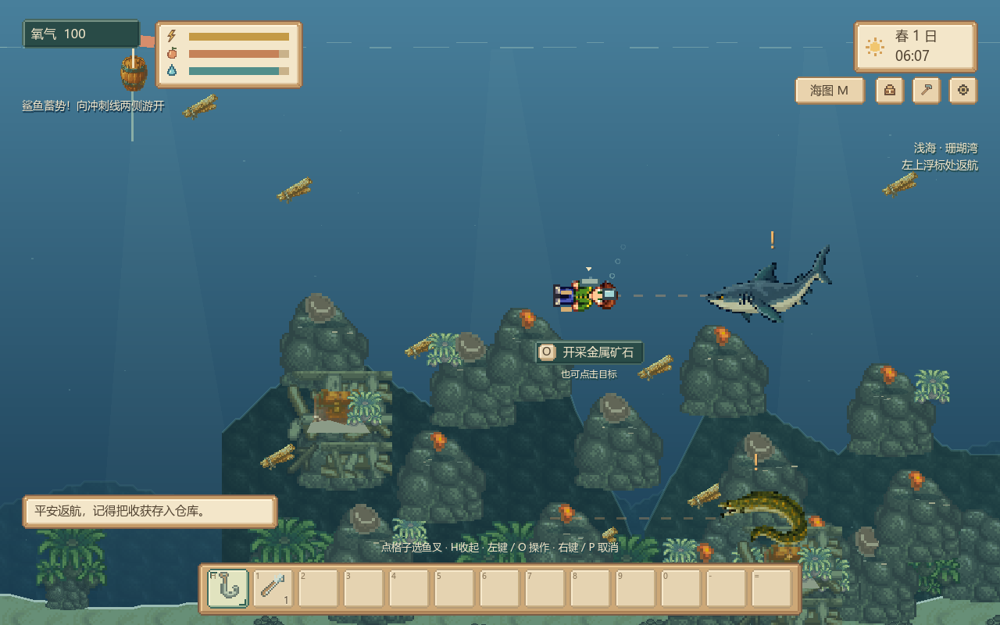

## 历史比例规范 v1.6（0.13.1，2026-10-16）

继承v1.5的32岛格/64筏格、完整人物和已认可UI。此次新增的实际画面按下表校准；技术与助手画面检查不代表用户已认可。原始生成图的辉光和非整数像素不进入游戏，保留原文件、运行时裁切/量化与来源哈希。

| 对象 | 原图 / 逻辑网格 / 世界尺寸 | 接地点与状态约束 |
|---|---|---|
| 双角色挥斧 | 各1536×1024、四向六帧；每格256宽→44逻辑像素，世界2倍；可见身体约54～58单位，与静态约56单位对照 | ChoppingArt统一脚点(22,42)，只扩大工具画布、不扩大碰撞；下劈越格和邻行裁切例外见actions/SOURCE。举斧/接触/收势取主机采集时间；取消不残留动作 |
| 基础工具/种子/食材 | 同源原生16×16图块，UI等比适配 | SurvivalArt真实索引，背包/快捷栏/配方/产物共享ArtCatalog出口；水壶格显示水量，物品数量在背包/悬停可查 |
| 熔炉、订单牌 | 原生16×32→32×64 | 熔炉闲置13/加工14共尺寸、接地y18；牌y16。不是整体拉高到与人物等高 |
| 筏上种植盆 | 16×48透明逻辑画布→32×96，实际盆体远小于整幅透明画布 | 空/幼苗/成熟共一个盆底，接地y16，原裁切组合在SurvivalArt；显示预算不改变64占地 |
| 潜水梯 | 新原图固定裁切420×890→12×25→24×50 | ArtCatalog预算24×52、y16；只有实际轮廓参与比较，不以透明画布代替可见高度 |
| 单格暖棚 | 原图665×718→16×17→32×34 | y16；打开的透明冷床框架、作物和前木沿分层，作物根部不浮在木沿前。只保护原一格，成熟天数未改 |
| 侧视沉箱 | 闭合564×366→24×16→48×32；开盖580×524→24×22→48×44 | 两状态底部y16、等宽48；只用于横版海底，不用它替换甲板箱子的俯视图 |
| 侧视鱼 | AquariumFish索引11原生24×24→48×48画布 | 不拉伸身体，不再画额外三角尾巴；可见鱼身约28～36单位。背包使用原生物品图 |
| 冬季作物 | crops冬种行23、0～3阶段 | 移除冷色春萝卜替代，仍按本作6个浇水日成熟 |
| 水岸、桥 | 原生土/水/码头木纹；桥16×16→32×32 | 河流中心线/宽度、湖泊与桥位置共享IslandMap；河水多边形与碰撞检查，边岸8单位只在水外。地图不另造地理，不能缩河宽来迁就贴图 |

最新检查：697项物资/状态/比例、154项岛图素材、36项地表/河流几何、123项挥斧逻辑；960×600/1280×800实景70项、宽屏/全屏与菜单128项通过。正常入口及最终包结果见verification.md，不能以本段代替。专用泳姿仍在P2-01，当前水下人物使用历史占位，不标作已完成；完整海洋生态、室内、NPC换装仍按原P1/P2范围。

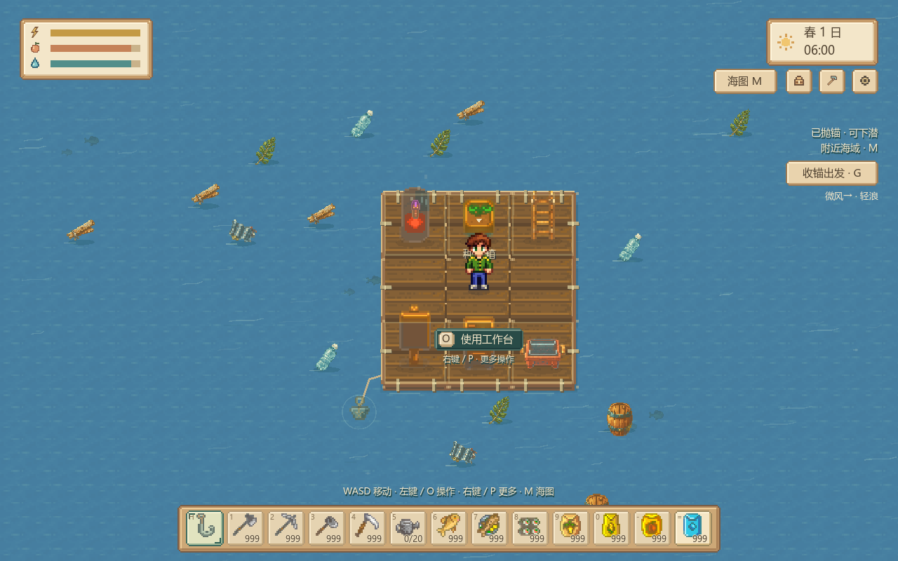

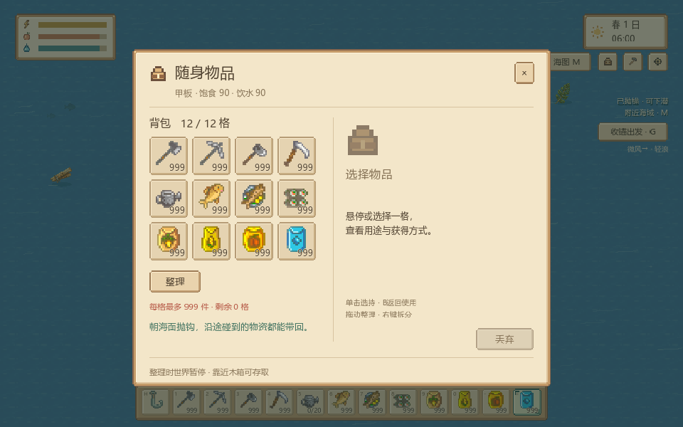

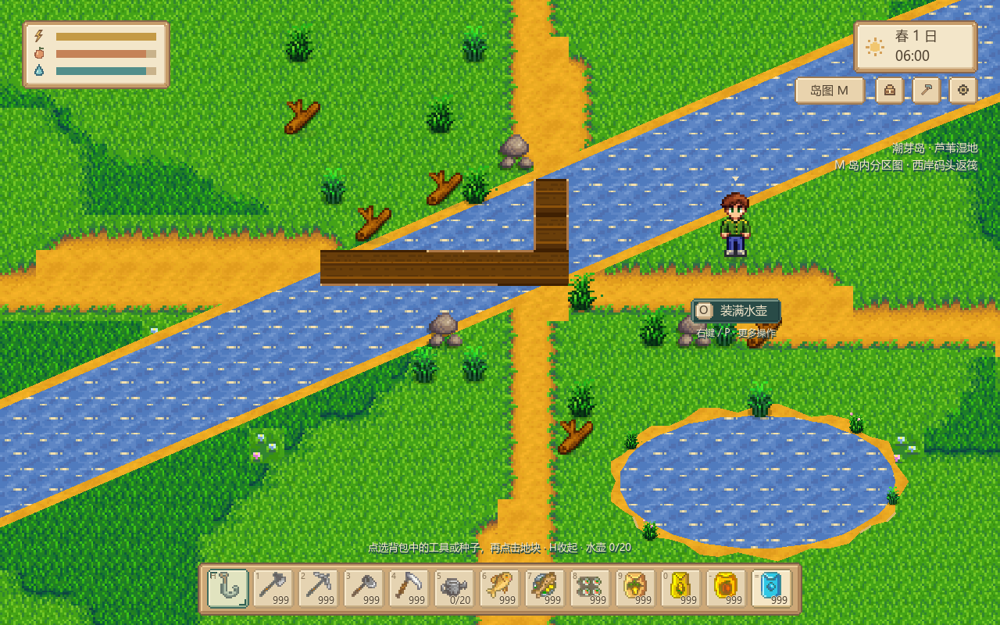

上述为助手核验的源码实景夹具，非自然开局或用户视觉认可；最终安装包单独验证。

## 历史反馈：0.12.1伐木动作未通过体验（2026-10-16，已由上方实施覆盖）

当前0.12.1人物仍使用普通站立帧，WorldView._draw_activity在人物旁连线摆动工具图标；图标角度和木屑按_elapsed推进，未与IslandActivity的duration/remaining构成逐次命中节奏。CharacterArt当前只接入完整人物的四向基础帧，未接入挥斧动作。本轮只读核对并更新清单，未修复游戏动画；既有采集规则测试不证明动作通过。

P0-11a验收标准：保持16×32→32×64与固定脚点；面朝目标并握住斧柄，人物躯干、手臂和斧头协调完成举斧、下劈、接触、收势，按实际采集进度逐次播放。木屑与树干轻反馈仅在接触时出现，不循环空砍，不晃镜头。移动/取消立即收动作，完成只按主机实际结算显示入包，不逐击重复发奖；主客玩家、四向、树前后遮挡都需验证。先核对授权归档可用动作与当前角色是否配套；缺帧明确适配或补画，禁止用漂浮图标或拼接异风格身体代替。需真实速度动作片段和正常入口验证，单张静态图不算完成；完整泳姿仍属P2-01。

## 0.12.1 放置预览与轻反馈（2026-10-13）

继续比例v1.5，无新人物/设施素材或尺寸调整。地板落位预览改用ArtCatalog的真实floor纹理（64×64），取消旧三条程序木板；设施预览仍用WORLD_PROPS。成功建造只画占地边缘短暂落尘，实体不缩放；加工完成为短微光并保留成品图标，上下潜/钩子接触为小水花。入包显示实际图标与增加数量，满包或动作失败无成功反馈。程序特效也遵守像素对齐、有限生命周期和静止镜头；这不是专用游泳/工具动画完成。

建造原因卡复用UIStyle纸张、文字和按钮提示，1280×800与960×600检查；仅选择建造/搬动时出现，屏蔽重复toast。物资小提示放人物侧上方，避免叠在头顶设施上。实际原图证据见verification及art-references/placement-0.12.1.png、pickup-0.12.1.png；用户观感待反馈。

## 0.12 工作台：比例v1.5补充（2026-10-13）

沿用现有规范，不调整人物、筏格或UI。固定归档的Craftables.png为128×1472，Workbench索引208对应原格(0,832,16,32)；只去掉顶端5行透明像素，使用(0,837,16,27)，2倍显示32×54，接地点相对设施中心y=18，占一个64×64筏格。ArtCatalog.WORLD_PROPS统一世界、预览、配方图；图标等比适配，原PNG不改，暖木材色边沿用PropArt。

状态：原图/索引/朝向/透明裁切已核对；637项现有素材比例检查通过，1280×800和960×600实际输入截图已查看，46项UI检查通过（含移台后的放置提示）。工作台图形可辨识为带挂架/工具的木制操作台；与人物同为2倍像素密度，背板高度不代表桌面高度。用户观感待试玩反馈。没有新增岛图地形或改变地图范围。参考实景见art-references/workbench-0.12.png；并非原作截图。

## 比例规范 v1.5（由v1.6继承，0.11.4）

2026-10-12用户确认目前岛上玩法可以，转向木筏、海上缩景及海底的素材统一；NPC外观低优先级。以下增补覆盖海洋场景，未列对象继续遵循下方v1.4。界面和完整人物保留；技术验证不能自动代替用户观感。

| 对象 | 原图与实际显示 | 出口及例外 |
|---|---|---|
| 木筏甲板 / 扩建预览 / 配方 | Beach原码头32×16木板重复两行成32×32→64×64筏格 | MaritimeArt.REGIONS.raft→PropArt→ArtCatalog；三处共用缓存。日照仅整体提亮18%，保留木纹与材质暗缝，不再用旧黑边阈值抹平原木纹。碰撞和绳索边缘保持 |
| 海面水纹 | 原岛图16×16水纹→32×32，四帧，低对比叠加 | MaritimeArt.draw_ocean；蓝绿海色与下潜水层同色域，水纹随航行平移；轻微筏体漂摆保持，镜头不摇晃 |
| 海底沙石 / 近景礁石 / 破船 | 同源Beach沙32×32、岩48×48、破船48×48，近景2倍 | MaritimeArt.REGIONS；浸水光照保留alpha和起伏，不修改原PNG。背景纹理压低对比，可采实体仍在实际点击位置 |
| 水下植物 / 碎石 | Beach植株32×32，前景2倍、远景装饰1倍 | 明确纵深例外；不是可采新资源，也不是专用侧视泳姿或完整珊瑚生态素材 |
| 海上岛屿缩景 | 小屋80×96→40×48；树48×96→24×48 | MINI_SCALE=0.5；这是航行辨识用的地图模型，不是可行走岛面。西岸港口、小镇、北林、东南院落作为示意；不是逐格缩印整个岛 |
| 缩景地表 / 小石 / 海图图标 | 地表16/32源纹理1～2倍；小石1倍；海图再统一缩至0.28 | 地图表示的明确例外，不能反推人物/真实建筑比例。海图与航行缩景共用构图与四季；未解锁岛屿仍为锁定轮廓 |

本轮用的是既有授权原图和原有码头地图片段，没有新增外部下载、生成原图或改写PNG。当前粗略示意岸线仍以保留航行避让半径为前提，后续可继续手工布景。人物游泳仍为现有临时表现，P2-01未完成；NPC差异化/开局选外观为P2-08。

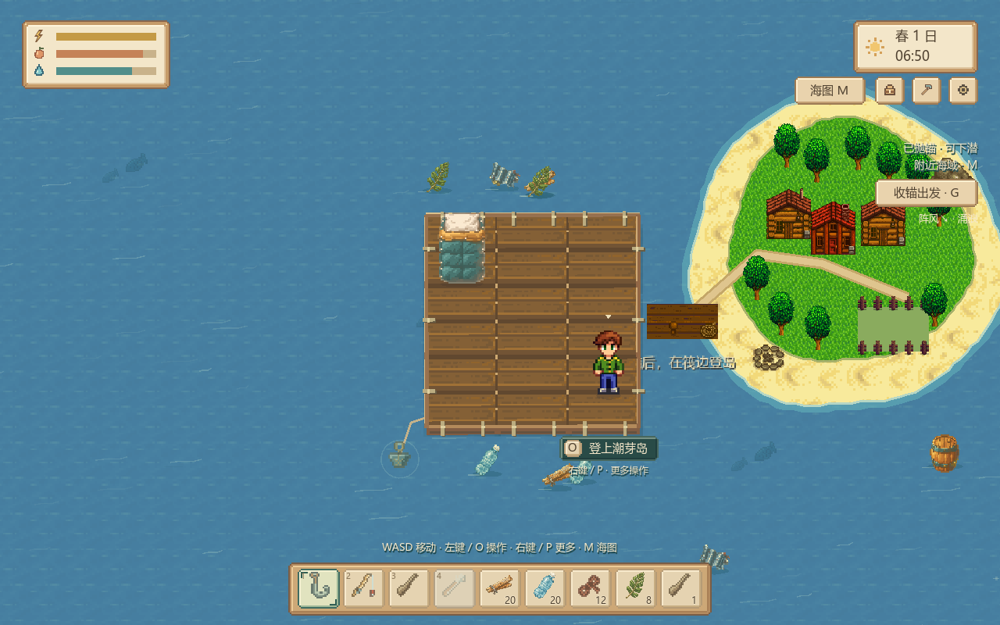

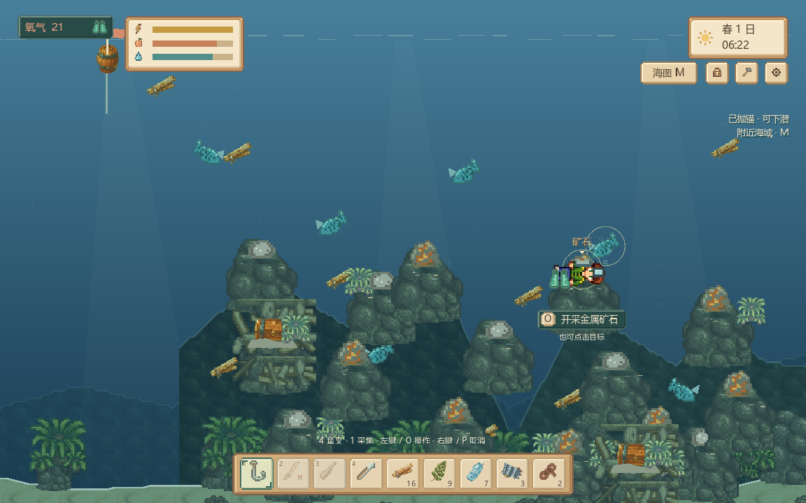

以上为助手已查看的实际场景夹具，非原作截图或概念图；自然开局验证单列于verification.md。用户观感尚待反馈。

### 0.11.3 岛屿规范与证据（继续适用）

2026-10-12：用户批准场景复用方案。0.11.3按原TMX分层接入成组建筑、石铺广场和码头，改用原生地形边缘；扩大的是建筑间距，荒院仍为48×36格外框。下面是当前生效标准。0.11.2整体环境曾被用户否定；本次实景由助手检查，仍待用户观感，不据技术测试关闭美术待办。

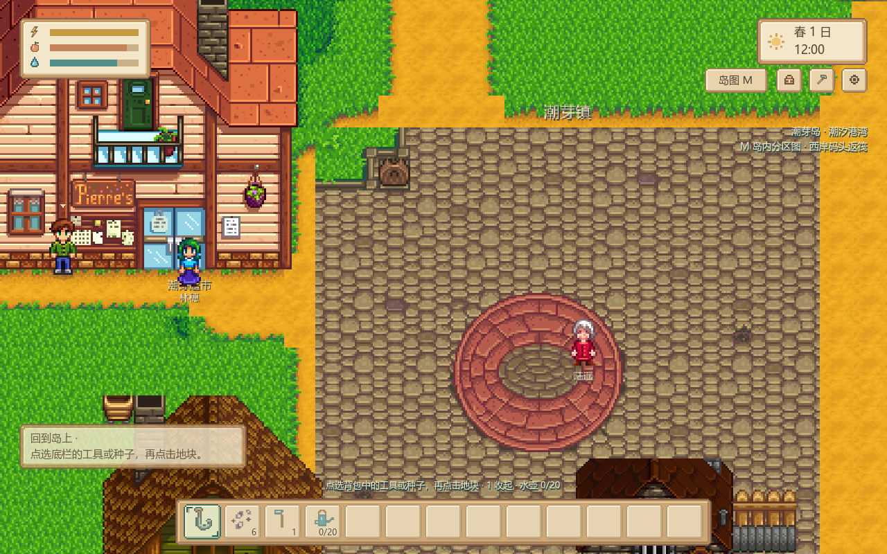

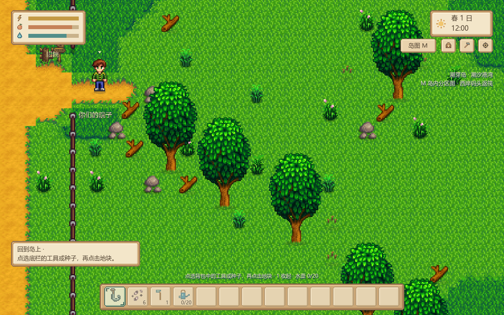

以上是游戏实际渲染，不是原作地图参考图。技术验证范围见verification.md。

## 岛屿比例 v1.4（由v1.5继承）

| 对象 | 原图与显示 | 统一出口与约束 |
|---|---|---|
| 人物 / 九位居民 | 完整16×32帧→32×64，脚点(16,62)，最近邻2倍 | CharacterArt；不用拼头身或改色替代角色。已保留0.11.2完整身体，专用泳姿仍缺 |
| 地表 / 草土接边 / 水纹 | 16×16→32×32，固定世界格 | IslandSurface、IslandTiles；四季切换完整图集，不能用透明平铺稀释纹理冒充边缘 |
| 七处店铺设施 | 原TMX层组合或完整原建筑区域，统一2倍，不拉伸 | IslandTiles.FACADES登记源格、脚点；IslandMap登记实体与门前位置。商店和诊所按原相邻立面衔接，其他建筑保留街区间隔 |
| 镇公所 / 两座民居 | 原有完整建筑2倍，原生门32×64 | IslandArt.BUILDINGS；屋顶可以超出地面占地，不能用屋顶大小作为人物碰撞范围 |
| 树木 | 48×96→96×192，源接点(24,84) | IslandArt.TREE_SCALE/TREE_FOOT；取消1.5倍树木例外，树根阴影贴地，树后显示淡化只影响画面 |
| 树桩 | 16×16→24×24，偏移(-12,-18) | 保留小树桩的既有例外；不是额外采集物。道路上被排除的旧树不显示残桩 |
| 可采草丛 | 16×20→32×40，偏移(-16,-32) | IslandArt季节行0/1/2/4；没有强制清理数量。空草地仍可走 |
| 干湿耕地 / 作物 | 土16×16→32×32；作物16×32→32×64 | 土边按实际四邻已锄格连接；仅实际锄地出土，不预铺耕田。成长继续使用现有4/7/10/6天数据 |
| 通行 | 人物脚掌12×6、子步≤6；树干16×14、石矿24×20 | IslandMap/IslandState；水岸、实体建筑、院栏阻挡，清除树石解除。渲染、碰撞和地图一起检查 |

其他船上设施继续沿用ArtCatalog，岛格32、筏格64、睡袋约44.5×64不变。UI使用已认可的UIStyle，不改为另一套界面。

本轮素材状态：

| 类别 | 状态 | 证据或仍有缺口 |
|---|---|---|
| Town/Beach地图组合、店铺、广场、码头 | 已实际接入，助手实景检查；待用户认可 | 原图与新岛屿场景分别保存，不能把原作参考图称为游戏截图 |
| 四季地表、树草、院栏、连片干湿土边 | 已适配；待用户完整体验 | 小水泊仍是几何岸线叠原水纹；野外并非完整手工布景，远处河岸/桥细节继续待调整 |
| 原始Farm/Mountain/BusStop地图 | 已读取用于参考，未作为可玩区域搬入 | 不能计作新增内容或完整岛屿 |
| 人物走路与居民 | 保留完整原帧、固定脚点 | 工具挥动、泳姿、NPC日程与特殊动作继续缺口 |
| 室内、暖棚、雪根 | 未完成适配 / 需补画 | 图集存在不等于玩法与场景完成；雪根仍复用冷色春作物 |

旧版v11几何单独冻结；与新建筑冲突的旧农田保留作物、成长、干湿与暖棚并就近迁移，人移到附近可站立位置。进入游戏前保存`.before-scene-0.11.3`原文件，常规保存不能覆盖它。其他旧档沿用原迁移规则；不改变存档版本号或重置世界。

下方为历史记录；发生冲突时以上述v1.4为准。

## 0.11.1 历史接入与比例补充

2026-10-12：用户要求开始实际替换。荒院围栏/门牌、镇公所/两处民居、通镇道路，以及整岛共用地表、树木、石块/枯枝/纤维/埋藏点、耕地与作物阶段已改用同一归档家族。原图/许可依据/哈希见assets/vendor/stardew-island；不是概念图，也没有搬运原作地图或改变成长数据。下文0.11后“尚未导入”段落为接入前历史，当前状态以本节及素材清单为准。

人物保留现有PIPOYA，原因及NPC扩充成本见reuse.md。真实走路切帧距离从6改为14单位，静止回中帧；仍未补横版专用游泳帧。四季街景、实际行走、农事与地图检查记录见verification.md。图片由助手查看，未声称用户已认可新场景。

**比例规范v1.2**在下方v1.1设施基础上加入本批岛屿值，岛格32、筏格64、成人48×48不变。IslandArt是本表运行时唯一出口，保存原图区域、显示倍率和接地点；不能为画面改现有地图入口或存档。

| 资产 | 原图区域/可见范围 | 游戏绘制与接地点 | 状态/例外 |
|---|---|---|---|
| 地表/泥路/水纹 | 图集16×16 | 重复单元32×32，UV按世界坐标连续 | 最近邻；草底原纹理25%叠加、土底45%，降低背景重复纹理对交互物的干扰；冬季道路复用完整春季土片，避免冬图过渡格透明裂缝 |
| 树 / 树桩 | 48×96 / 16×16；树底透明区不计高度 | 72×144，源脚点(24,88)；桩24×24、接点偏移(12,18) | 树的1.5倍为已登记例外，与成人同屏；冬季枯枝树；无随机变形；人在树后时整株淡至0.38 |
| 采集物 | objects16×16 | 32×32、偏移(-16,-24) | 只替换外观，工具/耗时/掉落仍由主机裁决 |
| 围栏 | 每片16×32，含透明留白 | 32×64，间隔32；横向偏移(-16,-48)，纵向(-4,-48) | 可见栏杆高度小于外框；西门112单位缺口及碰撞保持 |
| 镇公所 | 128×176，屋顶外轮廓裁除邻居像素 | 256×352，源门槛(56,176)×2 | 高屋顶可超出地面足迹；入口与地图位置不变 |
| 两处木屋 | 各80×96 | 160×192，源门槛(40,96)×2 | 两个原始外观变体，均为未开放室内的外景 |
| 新图集门 | 各16×32 | 48×96、脚点在底边正中，统一3倍 | v1.2明确例外：为保持原图长宽比及48宽成人通行标尺，高度96；旧程序门仍48×64。不是把门硬拉成48×64，需用户同屏观感反馈 |
| 单格耕地 | 干/湿各16×16 | 32×32，以地格中心为锚 | 原图为独立圆角土穴，连片自动接边尚未做；无预制耕地 |
| 作物 | 每帧16×32 | 32×64、偏移(-16,-48) | 原图苗/成熟/枯萎，按项目天数映射；雪根暂为春萝卜冷色变体，专用图仍缺 |

院门牌取32×32图集区显示48×48，固定院门旁，属于不碰撞标识；未作为可携带物品。树桩不是额外可收获资源。新建筑的屋顶遮到位于建筑后方的玩家时整座淡至0.38；与树后淡化一样仅为显示。门前、田前操作仍以既有世界坐标计算。地图共用地点数据，季节底色和院落填色同步；未增新区域或解锁。

本批实景：

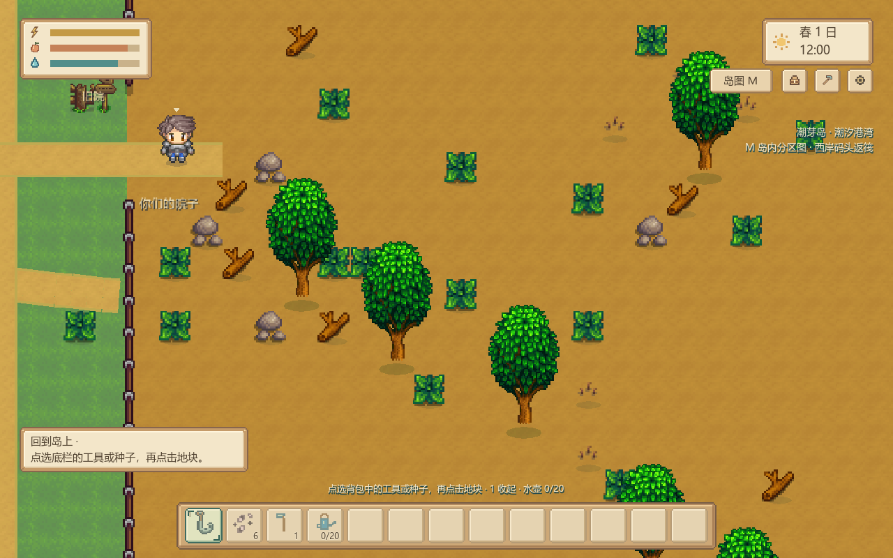

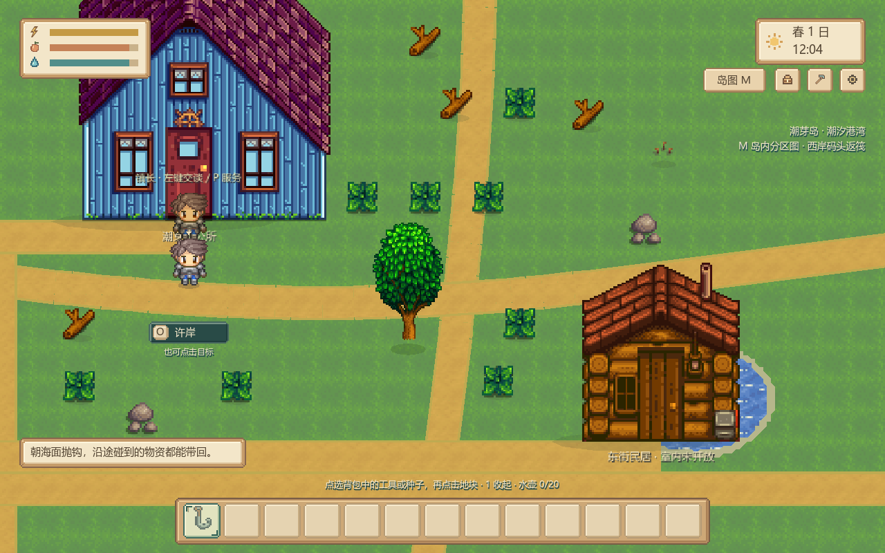

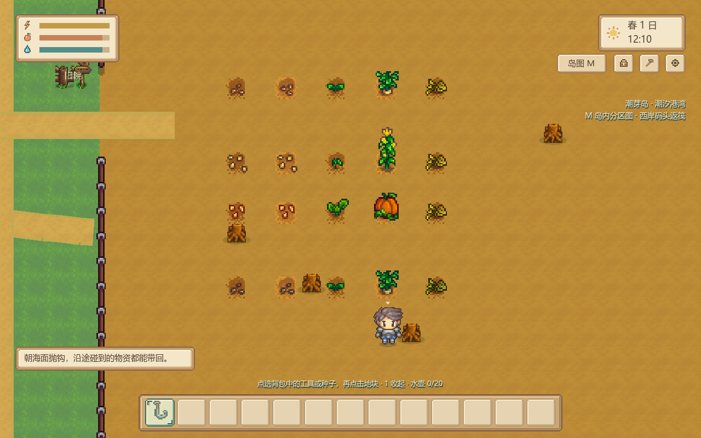

荒院图来自最终exe，其余为同版源码真实渲染。作物总览为状态夹具，自然过夜成熟另由正常入口回放验证。旧超市/诊所等外观、岸桥边缘、暖棚、雪根、独立NPC和泳姿继续留缺口。

更新：2026-10-12。0.11.1在v1.1基础上落实比例v1.2的岛屿资产；0.10.4的UI收尾继续保留；0.10.2已认可UI、0.10.3首组物件继续沿用，整体世界美术仍需分项验收。开发约束见 [AGENTS.md](../AGENTS.md)，排期唯一入口是 [TODO.md](TODO.md)，本文件维护视觉标准与素材验收清单。

## 方向与参考画面

温暖、清楚、有生活细节的2D像素海岛世界。甲板和陆地为俯视角，水下为横版侧视角；用一致的人物身份、物件造型、材质、色彩和像素密度连接两种视角。固定镜头，保留克制的海浪/筏体动效，不用镜头摇晃制造动感。

用户喜欢星露谷的精致感，已明确认可当前玩家人物与0.10.2首组UI整理。这是审美与保留依据，不代表星露谷素材可直接使用，也不代表现有环境或水下已经获认可。以下保存项目自己的实际画面，未编辑原截图；没有把商业游戏截图或原素材当作可分发资产。

2026-10-12最新讨论：用户明确引擎可以另选，当前优先讨论素材、UI风格及由助手持续制作的成本；现有素材需要大量修改，不能把已接入数量当作继续沿用更便宜的证据。本轮按“原作素材授权可解决”这一假设比较成本，实际授权状态不因此改变。建议以星露谷式的温暖、清晰、细节丰富的生活像素风建立统一标杆，UI先完成一套可复用样板，海上/水下按同一标准补充；具体画面和素材来源尚待验证与用户认可，未决定切换引擎或替换现有人物。代码参考及条件成本见 [reuse.md](reuse.md)。

### 0.11后岛屿素材路线澄清（2026-10-12）

用户本轮强调当前先完善岛屿素材与已有玩法，希望直接复用星露谷陆地素材。此前reuse.md确实提出“在授权范围覆盖项目的前提下，优先验证原作陆地素材复用”，不能将这段约定缩写成仅讨论相似风格，也不能据此宣称已经接入。0.11的院子围栏、建筑外观仍由现有程序绘制，树木、杂草及作物沿用旧来源；UI和部分海上物件的更新没有完成岛屿环境替换。

当前待讨论的制作建议：优先用同一完整素材家族验证一块真实可玩的“荒院＋通往小镇的一段路”，覆盖草地/泥土/水岸衔接、围栏与门、建筑外观、树木/杂草/石块、干湿耕地及作物各阶段，和已认可人物/UI同屏。先确认具体原图可用范围与缺口，再接入；若原作素材可用于本项目，先验证其陆地复用路线；否则另评估可用的同风格成套素材，不静默换成零散占位图或默认全量原创。用户当前要求是讨论，尚未开始本轮素材替换。

复用的主要适配工作是图集划分、透明边缘、像素密度、接地点/遮挡和生长/交互状态绑定；新建图集时仍执行比例规范v1.1，不靠逐物缩放补丁补救。验收必须在行走、采集、锄地、播种、浇水中查看实际材质与反馈，地图同步对应地点和地形；先完成这块场景，再扩至镇区、森林及海上/水下。已认可UI与人物作为同屏基准，比例或风格冲突需出示实景，不能悄悄替换人物。

授权信息随后更新：用户在范围讨论后进一步明确“有这个授权”，朋友完全同意使用其所有东西、所有资料。按用户确认推进筛选与适配，不重复要求确认同一事项；具体依据与公开文件历史保留于reuse.md及assets/sources.md。本轮未接入素材，实际资产状态维持待调整/需补画，统一排期见TODO的P0-16及IS-01/04。

首块场景目录初筛：以下依据提交0c31854的[inventory.csv](https://github.com/ffffhx/stardew-valley-assets/blob/0c31854d40fcc1f6b60b35ac07b7c9686b82b226/inventory.csv)，只验证目录列有文件及画布尺寸，尚未查看原图、确定切片坐标或通过实景验收。画布尺寸不等于单件物体世界尺寸，禁止整张图集直接缩放成一个物体。

| 候选用途 | 归档路径 | 目录标示尺寸 | 下一步核对 |
|---|---|---|---|
| 地形与户外衔接 | assets/Maps/spring_outdoorsTileSheet.png | 400×1264 | 草地、泥路、水岸具体切片及连接；同目录有夏/秋/冬版本 |
| 镇区建筑外观 | assets/Maps/spring_town.png | 512×1152 | 可复用外墙/屋顶/门窗组合、遮挡及门洞比例，不复制原作整镇地图 |
| 木屋外观候选 | assets/Buildings/Log Cabin.png | 240×112 | 图集状态边界、可见房体与接地点，是否适合荒院背景 |
| 围栏与入口 | assets/LooseSprites/Fence1.png | 48×352 | 连接方向、开口/门与损坏状态，保留现有院子尺度与通行 |
| 树木 | assets/TerrainFeatures/tree1_spring.png | 144×160 | 树冠/树干/生长阶段、脚点与砍伐反馈；已有季节变体 |
| 荒草 | assets/TerrainFeatures/grass.png | 66×240 | 实际帧宽、季节/状态及重复密度，不假设整图均为16像素格 |
| 耕地 | assets/TerrainFeatures/hoeDirt.png | 192×64 | 单格、相邻连接与干湿显示，绑定现有地块状态 |
| 作物 | assets/TileSheets/crops.png | 256×1024 | 本项目四季作物对应行、生长/成熟/枯萎状态，缺项单列补画 |
| 采集物与物品 | assets/Maps/springobjects.png | 384×624 | 石块、枝木及收获物具体ID/切片，核对世界与背包可辨识性 |

第一块场景继续使用已认可人物和UI作为比例/细节对照；本轮不扩任务、室内、独立NPC或新地形，素材落实时复用现有玩法状态并同步必要的地图显示。

### UI制作标准与首组样板

2026-10-12后续反馈：用户明确“目前这一轮UI整理，我觉得是比较好的，可以继续”，0.10.2首组UI方向/整理效果获认可，保留。新截图中的睡袋偏小，要求继续替换实际场景与物资；0.10.3海上常用物件生成、接入和同屏技术验证已交付，世界美术尚未因此获认可。

2026-10-12用户先同意以下制作标准，后认可0.10.2首组UI整理；其余页面与新世界素材仍需实际反馈。方向认可、技术验证和整套视觉验收分别记录。

- 视觉起点：浅暖底色、克制的木质边缘、深棕文字与青绿海洋点缀。局部材质细节服务辨认，避免每块面板都铺满木纹、粗黑边或重复装饰。文字保持中文小字号可读，不强行把字体做成低分辨率图。
- 布局起点：探索时以游戏世界为主，仅保留必要状态、日期和快捷栏；氧气等情境信息按需要显示。背包和制作打开后再呈现详细内容，交互提示只解释当前可做的动作。
- 共用部件：可伸缩面板边角/边线、物品格、按钮、分类页签、提示框和状态条。先固定色板、字号层级、间距、边缘厚度及图标设计像素密度；数字、文案、进度由控件绘制，不生成包含文字的整张菜单图来接入游戏。
- 共用状态：普通、悬停、选中、按下、不可用；补足空格、数量、水量/耐久、材料不足、满包、同伴占用等实际情况。选择状态需形状或边缘提示，不能只靠颜色。物品大类图标不能替代具体物品身份。
- 页面扩展：背包、箱子、制作、商店复用同一物品格、提示和按钮；地图、对话沿用文字/面板规范，按信息用途另做布局。页面可有不同结构，不要求复制同一大框。
- 制作方式：复用现有UIStyle与背包/箱子交互逻辑，集中整理视觉样式和页面布局；不为换肤建立新框架。像素边角、图标可制作/修整，布局和状态通过代码保持一致。未来若换引擎，色板、图集和组件规格可延用，控件实现仍需移植，不能算零成本。

第一组交付样板使用同一真实游戏背景，覆盖探索HUD、12格背包与16格箱子、制作配方三种界面；用当前真实物品和规则，检查长中文名、两位数量、空格/满包、缺材料及不同窗口尺寸。新样板不恢复已移除的农事动作按钮。先让这一组的布局和风格得到认可，再扩展其他菜单；随后用陆地/甲板/水下实景验证整套素材路线，最高风险仍是跨视角角色与连续动作。

比例规范v1.2是当前世界素材基线；最终视觉样板若要求调整标尺，应统一修订规范与证据，不能在各场景临时缩放补丁。

#### UI皮肤 v1（0.10.2实现）

- 共用颜色：文字`#514332`、辅助文字`#857256`、纸面`#F3E6C9`、海绿强调`#3F715F`；材质边缘从棕木/纸色过渡，不用纯黑框。选中格增加两角形状标记，不只改变底色。
- 共用图形：沿用并重绘12张32×32 SVG皮肤；纸面九宫格固定角区10单位，其余8单位，内部文字与数字独立。UIStyle集中加载、缓存；物品格/快捷栏/配方使用同一组普通、悬停和选中样式。
- 排版：页面标题28、物品标题22–26、正文17–18、辅助14–16；HUD与紧凑数量允许更小字号，必须通过960×600实际渲染。背包72方格、80间距；12格背包与16格箱子并排，右侧独立物品说明，底部显示实际操作和时间规则。
- 制作页：分类与配方在左，选中物品、用途、逐项材料与操作在右；缺料同时显示红色数字和“还缺”文本，地点变化时材料来源说明同步变化。岛上不能宣称使用甲板木箱。
- 探索页：暖色状态/日期、木质快捷栏，情境提示集中到底栏上方；不适用的工具图标降低不透明度。氧气仍只在水下显示，保持固定镜头及已有输入规则。
- 0.10.2继续使用现有物品图标与人物；未把旧图标精细度、世界比例、环境细节、旋转站姿游泳标为完成。新SVG来源见[assets/sources.md](../assets/sources.md)。

实施及验收入口：[implementation-0.10.2.md](implementation-0.10.2.md)、[verification.md](verification.md)。运行时技术检查与实际截图不能代替用户审美认可。

下列三张来自打包版0.10.2的正常输入回放，原图未编辑；证据目录为`artifacts/playthrough-20261012-004014-182/`，对应01-opening、06-inventory、02-recipe-book。用户后续认可首组UI整理，背后的旧世界素材不包含在这一认可范围中。

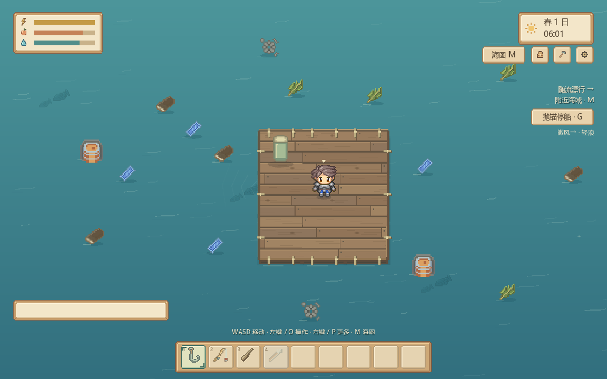

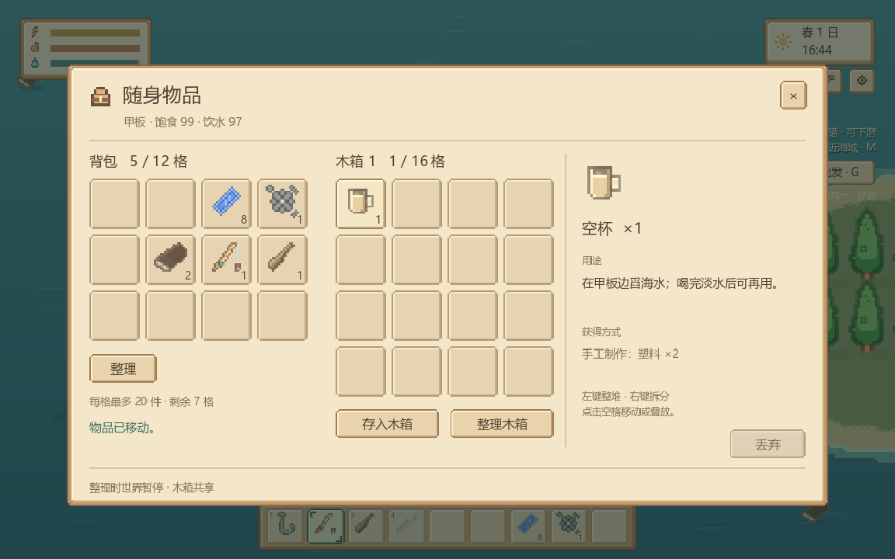

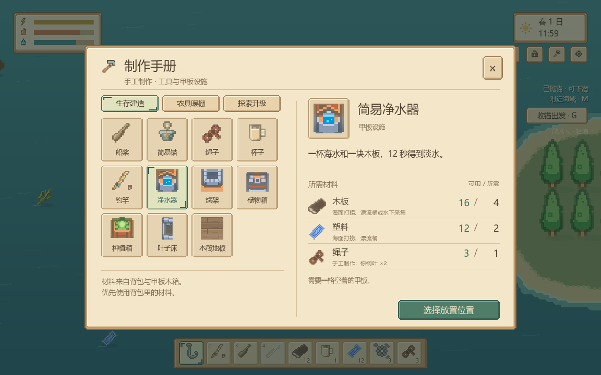

### 0.10.3首组场景与物资实景

以下原图来自最终Windows包`artifacts/coastal-release-0.10.3/`，由助手查看实际渲染；开局图通过正常新游戏按钮进入，设施总览为受控摆放夹具。首组11张新素材已通过比例、实际输入、库存与保存检查；这些证据不代替用户对新图的审美确认，也不把仍在画面中的旧熔炉、种植箱、梯口和订单牌算作新素材。

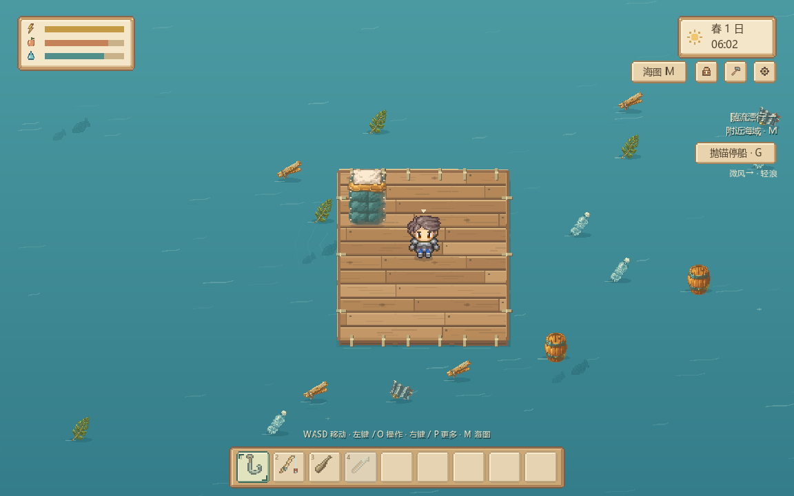

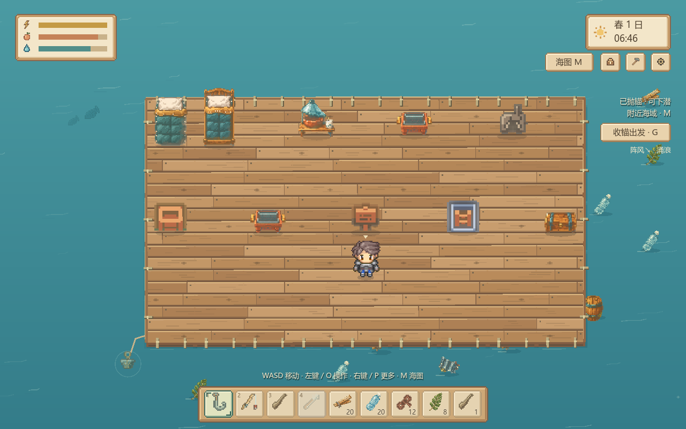

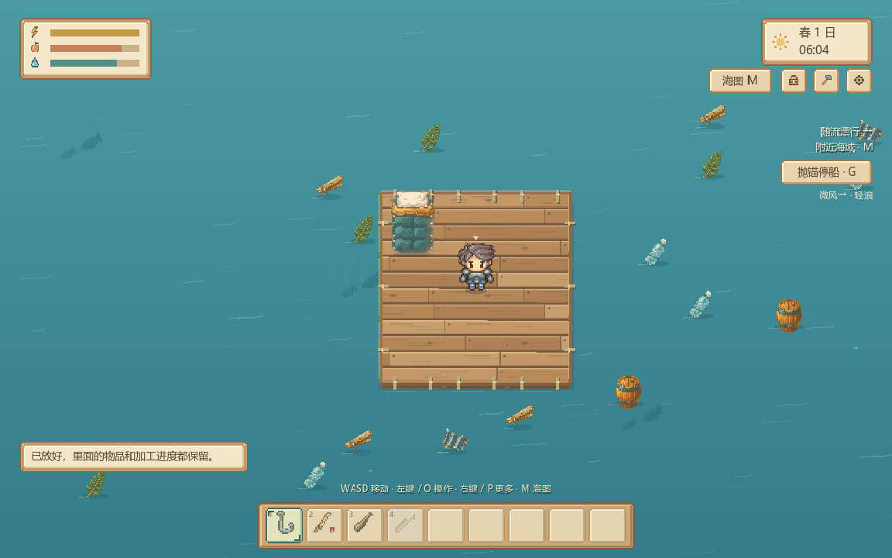

首组共用15个设施/状态尺寸和接地点；UI、世界与预览复用纹理，保留原图及固定裁切/显示网格。源码62项图形输入和最终包46张夹具、5项入口/存读检查通过；完整自然开局与本机联机的具体构建范围见[verification.md](verification.md)。生成方式、原图与提示词见[来源记录](../assets/coastal/SOURCE.md)。

### 0.10.4 UI检查与维护结果

沿用已有纸面、字阶、物品格和布局，仅修复有实际输入/截图证据的问题：丢弃确认优先接收快捷键，Esc/B只取消确认；地图悬停/选中采用UIStyle的map_hover/map_selected透明描边，不能用不透明物品格皮肤遮挡地形。标题/联机页原有动态增高正常，保留其实现。

当前检查覆盖960×600、1280×800、1440×600与原生全屏，含背包/箱子、制作、丢弃、海图/岛内分页、镇内对话、暂停和存读。127项真实UI输入、7项地图样式/渲染像素对照、最终exe48张夹具/8项检查通过，见verification.md；图片由助手查看，不代替用户对每个页面的审美验收。

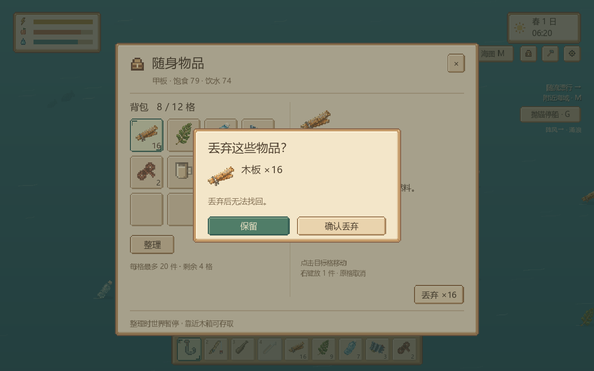

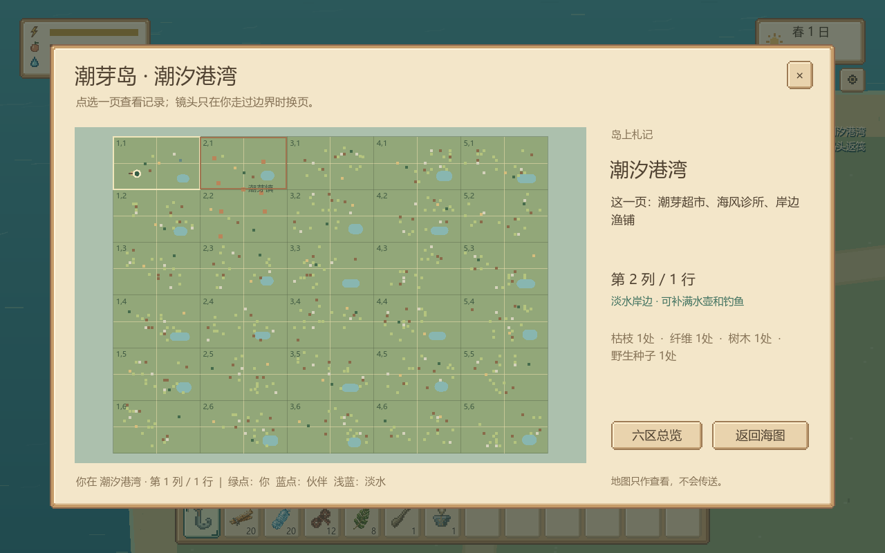

| 本轮保留的参考 | 采用/保留的部分 | 尚不能据此认定完成的部分 | 来源 |
|---|---|---|---|
| 陆地0.10 | 已获用户认可的玩家身份与头身比例，固定俯视视角，人物相对田格的可读大小 | 地形细节、建筑、植物和UI整体精度仍待调整 | artifacts/playthrough-20261005-122943-871/08-resumed-farm.png，正常流程 |
| 湖岸0.10 | 青绿水体、偏暖土地和材质色边缘可作为本轮色彩方向；湖岸/桥的空间关系可读 | 树形、重复纹理、桥与水岸衔接细节尚非最终品质 | artifacts/town-ui-3957151/lake-shore.png，位置夹具 |
| 水下0.8.1 | 同一玩家身份、工具/资源能辨认、横版视角 | 旋转站姿、鱼与矿物的比例/精度是待修正对照，不是认可的最终游泳方案 | artifacts/playthrough-20261005-103239-554/06-fish-spear.png，历史正常流程 |

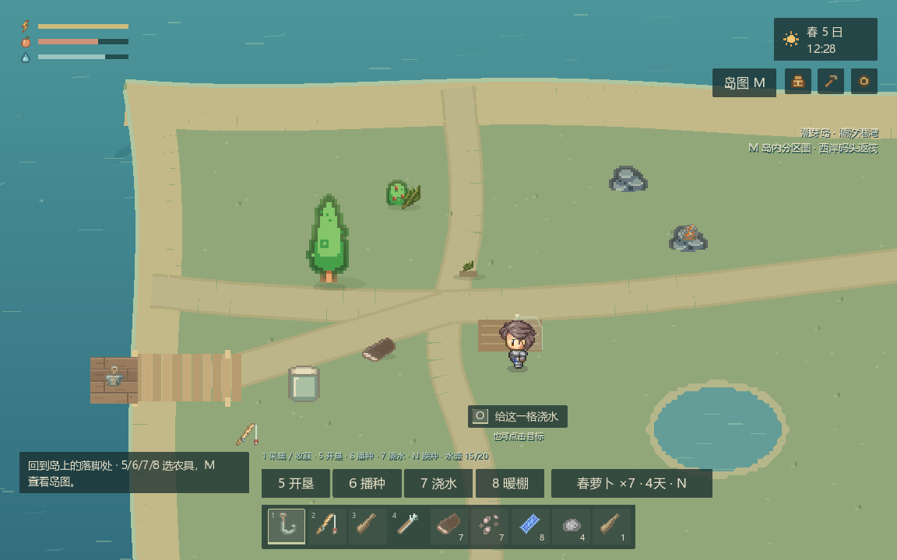

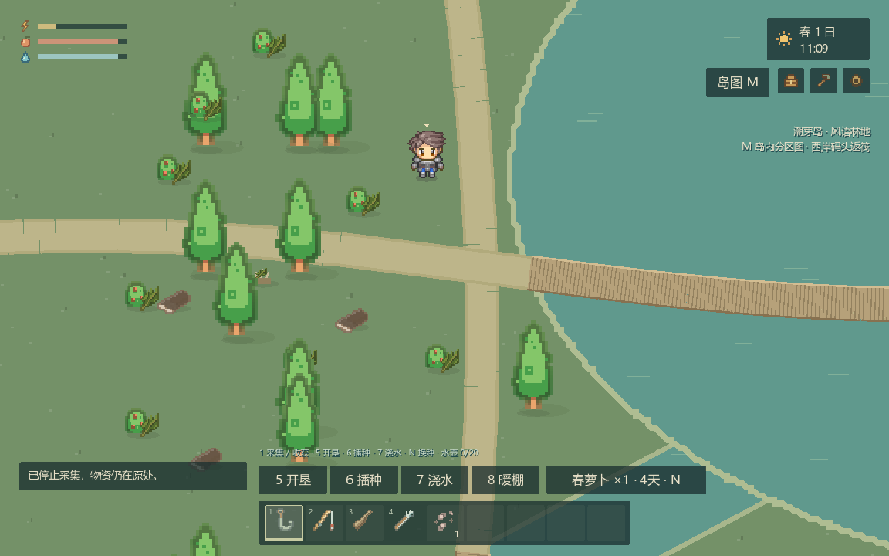

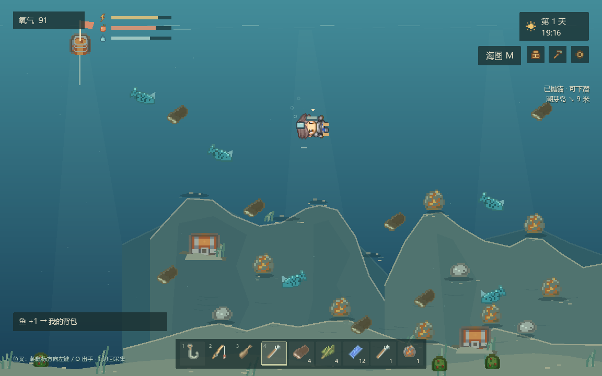

这些图来自不同版本，只用于建立参考和识别缺口，不能证明同一版本陆地与水下已统一。后续P0-16必须补同版本实机对照；新参考需写明版本、来源、认可的具体方面和仍未认可的方面，保留旧记录。

## 像素、比例与视角

| 项目 | 接入标准 | 当前实现与差距 |
|---|---|---|
| 像素采样 | 使用最近邻采样；保持原图宽高比。记录原生像素尺寸及实际显示尺寸，不用模糊、任意拉伸掩盖风格冲突 | 项目已用最近邻。16px图标、原生32px人物、16px设计放大到32px的物品并存，仍需检查混用后的视觉像素密度 |
| 玩家与成人NPC | 以已认可的Pipoya玩家为锚点，保留其头身比、脸部细节和四向辨识；成人同场景采用相当显示比例。换装/潜水后仍能认出同一人 | 玩家每帧32×32，当前绘制外框48×48逻辑单位；岛上格子32×32，外框约1.5格，透明边不计人体。NPC目前40×40，差异列待调整，不能把缩小当职业差异 |
| 地格与建筑 | 岛格32逻辑单位、筏格64逻辑单位是玩法网格，不强制全部素材原图同尺寸。按玩家脚点核对门、床、树干、箱子、工具与碰撞范围；建筑可跨多格 | 玩家以脚点落地，树/建筑可以遮挡但不能藏住关键交互。新增建筑先做人物站门口及行走遮挡对照 |
| 陆地/甲板视角 | 俯视且能看到人物与物件的侧面厚度；同类资产俯视角度一致，底部接地，阴影方向一致 | 不混入等距建筑或纯侧视柜子。地面装饰与能采集/碰撞的对象要能区分 |
| 水下视角 | 横版侧视；需要真正侧向身体姿态和侧向工具动作，物体在水中应有合理朝向、尺度与浮沉关系 | 历史旋转站姿已于0.16退出；当前专用泳姿与验收范围见v1.10，不能退回占位实现 |
| 道具与图标 | 同一种物品在海面、水下、场景、背包、配方和预览中保持身份与主色；世界尺寸服从实际用途，图标单独适配格子 | 继续复用ArtCatalog/PropArt出口；源图大小一致不代表显示比例一致。木桶/闭箱/开箱必须逐状态看 |

不规定全画面必须一律放大相同倍数：新素材先与实际玩家和邻近物件同屏比较；若非整数缩放导致像素宽窄跳动、边缘闪烁或混合精度明显，记为待调整并修改素材/显示方案。当前48/32的显示比例是已存在的事实，不作为未来所有素材都采用1.5倍缩放的许可。

## 比例规范 v1.2（历史设施基础，冲突由v1.3覆盖）：同一把尺，按用途分尺寸

生效日期2026-10-12，基于0.10.3设施及本页0.11.1岛屿补充表；后者覆盖本批图集资产，未列项沿用下表。以下是本项目制作约定，不是第三方游戏的内部标准。表中“已接入”是当前实际尺寸，“待校准”只是未来候选预算；两者不得混用。强制要求是保宽高比、登记尺寸与锚点、区分用途、统一各状态及验证交互。代码元数据是运行时唯一出口，本节是制作/审查依据；二者变更必须同轮同步。

### 四种尺寸必须分开记录

- **原图画布**：文件或图集一帧的像素范围，例如人物32×32；包含透明留白。
- **可见轮廓**：实际非透明内容的包围盒。静止正面两位玩家的原图分别为26×32与23×32，不能把两个32×32画布理解成同样宽的人。
- **世界尺寸与占地**：绘制矩形、脚点/接地点、地面占用、碰撞和交互范围分别记录。树冠可以跨格，树干占地较小；改变树冠图片不能顺便改变能否通行。
- **UI图标尺寸**：为背包/配方辨认而单独适配。同一杯水可以在菜单中放大，在人物手里保持小尺寸；大图标不代表游戏里存在巨型杯子。

实际屏幕大小还要乘世界或UI层倍率及窗口变换。规范以世界逻辑单位计量，不按某张截图的屏幕像素倒推。窗口调整由公共视口控制，禁止逐个物件随分辨率重新配大小。

### 标尺与生效尺寸

0.10.3校准结果：旧睡袋32×48试验预算已废止，不能用于新增或替换资产。现有32×46显示网格以46×64预算等比适配，实际约44.5×64世界单位；床32×58网格以44×76适配，实际约41.9×76。接地点分别在玩法中心南侧30单位，床头允许向北超出地面占格。睡袋主体能容纳48单位成人，同ID甲板/营地/预览同尺。这些值只作用于显示，不改变玩法占格/碰撞。

设施预算/接地点集中于ArtCatalog.WORLD_PROPS；CoastalArt记录原图区域与24–36像素宽的展示网格。角色统一使用CharacterArt的48×48及固定脚点；成人NPC已对齐。公共_sprite/_item改为等比适配，普通门洞改为48×64且立面、窗、招牌一并移位；不因此宣称建筑室内可进入。树鱼、地形、严格全屏整数缩放与角色完整动作仍待进一步校准。

保留现有岛屿格作为基础尺：**U=32世界单位**；筏面一块甲板为**64×64=2U×2U**。两种格子表达不同建造密度，不需要为了美术统一改存档或把整个岛改格。玩家正面站姿的可见身高 **H=48世界单位=1.5U** 作为人物基准；沿用已认可形象，环境围绕人物调整。

2026-10-11直接读取两张本机PNG的alpha进行核对：正面站立帧都满32像素高；12帧可见高度，男角色31–32、女角色29–32。步态导致轮廓变化是正常的，不能逐帧自动裁切并放大到同一高度，否则人会忽大忽小。固定帧画布、统一缩放与脚点，检查动作全过程。

| 类别 | 当前值或待校准预算（世界单位，另注明UI） | 对齐及使用规则 |
|---|---|---|
| 玩家与普通成人NPC | 32×32原帧统一按48×48绘制；成人默认使用同一标尺 | 以站立脚点定位；不能为了职业区别随意缩成40×40。儿童/特殊体型单列定义，不修改全体倍率 |
| 岛上田格 / 筏地板 | 32×32 / 64×64占地 | 保持当前玩法坐标、种植一格一株和建造网格；地表纹理不得假装成不同尺寸的可交互格 |
| 普通木箱、木桶（已接入） | 箱闭合42×26.25，开盖42×35.44；桶约29.56×38 | 箱体接地点+16，桶+18；开盖箱底误差不超过1单位、宽度不变。不能将较高开盖图压成闭合图高度 |
| 睡袋 / 单人床（已接入） | 预算46×64 / 44×76；等比实绘约44.52×64 / 41.93×76 | 接地点+30；甲板、营地和预览共用。睡袋主体长于成人且外框不超过64格；床头上探是明确视觉例外，地面占格不变 |
| 普通门洞（已接入） | 开口48×64，外框56×68；双扇门另行登记 | 门口能容纳约35–39宽的人物；门框不算开口。仅门前服务，未实现室内进入 |
| 净水器 / 烤架（已接入） | 预算48×50 / 46×36；实绘48×49.33 / 46×30.67 | 接地点+18 / +17；加工效果叠加不改变设备主体尺寸；厨房暂共用烤架，独立美术待补 |
| 桌、工作台等（待制作） | 先定32或64的占地档，再以人物同屏决定外形 | 地面足迹、台面高度、可见上沿分别登记；工作台尚未实现，不能借尺寸登记算交付 |
| 普通成熟树（待校准） | 候选可见高度96–144（2–3H）；树干和冠幅单列 | 幼树、灌木、巨树分开，不能全靠任意随机倍率；树冠遮挡与树干碰撞分离 |
| 常见鱼（待校准） | 候选侧视体长16–32（约1/3–2/3H） | 同种鱼固定体型；大鱼/鲨鱼另登记，食材图标不代替活鱼动作 |
| 背包、快捷栏、配方图标 | 使用各控件既有图标框，主体长边以框内80%–90%为起点 | 等比容纳并留数量/选中标记空间；长工具保形状，必要时另画图标，不把它压成方块。百分比是起点，不是像素级硬保证 |

完整设施值在ArtCatalog.WORLD_PROPS：其余旧图熔炉42×48/+18，种植箱三态、订单牌、梯口均42×42/+16；这些是保留的等比容纳预算，不代表旧图已达到新美术质量。表中“实绘”是裁切后纹理绘制矩形，并非每个像素都不透明；接地点为相对玩法中心的Y偏移，绘制位置取整可产生小于1单位误差。

每个已接入ID只能使用明确尺寸；同类例外记录原因、对照图和验收状态。大型设施跨格时先明确占地和路径，不把过大的图画进一格后再补碰撞。

### 后续必须执行的维护规则

1. 制作前记录ID/用途/俯视或侧视、原图/帧区域、可见轮廓、逻辑像素网格、世界预算/接地点、玩法占地/碰撞、各状态及UI图标框。新设施先入WORLD_PROPS，新人物先定CharacterArt标尺；不能靠world_rect的默认值交付新资产。
2. 实物、营地副本、建造/搬动预览走同一世界几何；UI走等比容纳。不得按窗口或帧分别把人物/物品放大到固定轮廓，不改变玩法网格来迁就素材。
3. 先运行prop_art_checks（覆盖全部制作设施元数据、原图裁切区域、源文件无修改、比例/接地点/箱盖状态），再做960×600和1280×800实际点击/搬动/状态切换。布局变动另做宽屏及全屏鼠标映射；截图中保留人物和正常UI，说明是否夹具。
4. 同轮更新本页的生效值、ART清单、TODO及来源；记录日期、改动原因、验证路径、接受范围与未完成项。旧值移入历史，不能与当前表同时称为标准。原图/外部许可更新才改来源证据，不凭视觉修改声称获得新授权。
5. 岛屿下一阶段使用同一标尺；院门/镇长/院内地块/工具/各作物状态先同屏核对。实际地点与可达路径改变时，同步海图、岛图、分区图及锁定状态；地图规划不等于场景已建成。

### 像素密度、视角与屏幕缩放

1. 保存源图的**设计像素密度**。Yapi的32px文件实际上是16px设计的两倍版本，不能只看文件尺寸就认为它与原生32px人物同样精细。用于世界主体的候选要与人物轮廓细节同屏比较；粗像素图放得太大时需要重新绘制细节或换素材，最近邻放大不会补出细节。
2. 保持源图/帧的宽高比和固定锚点；任意非等比拉伸不用于人物、床、箱子等刚性对象。火焰、水草等明确的形变动效单独登记，不能成为全体资产拉伸的例外。图集取帧不能连邻图透明边一起误算尺寸。
3. 甲板/陆地用俯视资产，水下用侧视资产；共用身份、配色和尺寸档，可以采用不同的实际图片。同一物品不强求所有视角共用一张PNG。
4. 最近邻只规定采样方式，不能自动保证所有窗口都像素均匀。当前世界布局900×560、UI布局1280×800，外加窗口伸缩；现有1.5倍人物与分数视口倍率尚不满足严格的全屏整数像素标准。参照 [Godot 多分辨率说明](https://docs.godotengine.org/en/stable/tutorials/rendering/multiple_resolutions.html)，后续将最终世界倍率与取整集中验证，不能仅改一个整数缩放开关就宣称完成。
5. 保持用户要求的无固定黑边、固定镜头及可调整窗口。若采用整数倍率方案，须同时验证额外可视区域、背景铺满和鼠标坐标映射；不能靠加回黑边、裁掉交互区或晃动镜头满足像素检查。UI可保留独立的清晰文字倍率。

### 历史审计（0.10.1；不得作为当前尺寸依据）

2026-10-11按0.10.1源码和本机原图核对。下表前四项已在0.10.3修正：成人48、卧具共用几何、门洞48×64、公共等比绘制；最后的树木像素密度仍未完成。原数值只保留作为问题来源，不得重新用于新素材。

| 位置 | 当前事实 | 修正要求 |
|---|---|---|
| world_view._draw_players / _draw_town | 同一32px人物来源，玩家48×48、成人居民40×40；NPC线性尺寸只有玩家的83.3% | 成人共用角色尺寸与脚点约定，帽子、名字和提示位置随基准对齐 |
| PropArt.bedroll_texture / world_view._draw_structures / _draw_island / _draw_placement | 睡袋原图16×24；甲板30×45保比例，岛上42×42与预览43×43把2:3拉成1:1 | 同ID的实际物体与预览共用几何，只改变预览透明度；库存图标独立等比容纳 |
| world_view._draw_town | 门内20×26、门外框26×30；玩家可见宽约34.5或39、高48 | 房屋立面和门一起校准，不能只把门图放大后盖住窗口/招牌；可进入室内仍属后续玩法 |
| world_view._sprite / _item | 直接把纹理画入调用方给定的矩形；多数世界尺寸分散在各处 | 复用现有素材目录管理尺寸/锚点；公共显示入口保比例，场景传位置、朝向、状态，不再逐处临时定尺寸 |
| world_view._coastal_tree / CharacterArt | 16×32树图默认画48×96（设计像素3倍），32×32人物画48×48（1.5倍），叠加相同世界缩放 | 同屏比较粗细；尺寸合理仍可能精度不匹配，不能用统一源图分辨率冒充风格统一 |

### 新增素材的记录与验收

**先登记，再接入，再实景验收。** 素材记录至少包含：ID、用途（世界/图标/预览）、场景视角、源文件与帧范围、原图/设计像素尺寸、可见轮廓、世界显示尺寸、锚点、占地/碰撞/交互范围、动作状态、UI适配方式、来源许可、验收证据与例外原因。

显示数据收进现有 ArtCatalog / CharacterArt 的公共出口；允许必要的小型数据表，不另造素材引擎。0.10.3已实现首组WORLD_PROPS、CoastalArt显示网格、成人脚点与34项新增几何检查；其余环境、完整动作与全屏像素统一仍排在P0-18。不能把局部实施算成整套尺寸约束已完成。

最小实景标尺由同一版本的**人物、成人NPC、一扇门、一张床、木箱、木桶、一棵树、一格田**组成；桌椅/工作台到实际制作时加入。甲板、岛上、水下分别验证，屏幕比例相同；图标另排一列，明确它不是世界真实大小。

验收分两层：

- 技术检查：尺寸定义完整、帧边界正确、宽高比保持、锚点不跳、开关/加工/预览尺寸一致、点击目标与实际物体对齐、碰撞/放置与旧档不变；缺项不能标已验证。
- 实机观察：先在1152×720，再在960×600、1280×800及全屏检查清晰度、遮挡和鼠标操作；人物走到门口、箱边、床边、树后，再走完登岛/下潜/返筏。记录静态截图及短动作片段，保留UI。技术通过与用户审美认可分开。

首批修正顺序：角色与成人NPC标尺 → 睡袋/床及预览 → 门口与设施 → 树、鱼和其他跨场景资产 → 像素密度与视口。调整绘制尺寸不自动扩大交互半径，不变更玩法网格、配方或存档；确需改占地时单独列出迁移与联机验证。

## 色彩、边缘与动作

- 陆地偏暖木色、亚麻色与植被绿，海面和水下用青绿/蓝绿连接；水下可更冷、更暗，但人物、鱼叉、鱼、矿点与宝箱必须从背景中读出来。
- 材质色锚点沿用 [prop-palette.md](../assets/prop-palette.md)：木材`#987958`、亚麻`#9c9981`、金属`#81928b`、石料`#939489`、植被`#7f9461`、水`#709d9f`。这是适配起点，不是给所有原图套同一种灰色滤镜。
- 避免物资、设施和UI出现突兀的厚黑框；轮廓用较深材质色，内凹处可保留暗部。已认可人物走独立人物素材出口，不能为统一轮廓把人物细节全部抹掉。
- 同一素材必须检查闲置、操作中、完成、打开/关闭、空/满、种植各阶段等实际适用状态。不能只改木箱闭合图而漏掉开箱，也不能只改背包图而漏掉水下实体。
- 动作至少要表达准备、作用方向、命中/完成和恢复。没有完整帧组时允许保留明确占位继续开发，但素材条目仍为“需补画”；不能让动作与采集计时/命中判定脱节。完整行走/游泳工程仍由P2-01排期，当前P0-16必须先识别并验证视角与基本姿态，不能假报动作完成。
- 同一背景、视口和实际游戏速度下检查人物移动/转向、挥工具、抛收钩、游动/鱼叉和受影响物体；静态接触表不能证明动作连贯。UI须保留正常字号、物品格、提示和交互目标的清晰层级，不能靠隐藏UI完成好看的截图。

## 素材状态清单

状态含义：**已验证**仅限该行写明的范围及证据；**待调整**为已有素材但比例/风格/状态或验收仍有缺口；**需补画**为适配视角/动作/独特内容缺失，可以补画或找到授权合适的替代素材。后两类都不能记为完成。授权记录与视觉验收分开，许可齐全不等于美术通过。

各行保留自己的核对日期；后续修改某行时更新该行日期和证据，不把整表批量改成已验证。

| ID / 类别 | 状态与验证范围 | 当前来源/证据 | 缺口与下一步 | 对应TODO |
|---|---|---|---|---|
| ART-01 玩家陆地形象 | 0.16配套换装/行走/挥斧已本地核验，待用户观感。2026-10-24 | 同一原生身体/衣发/手臂及固定脚点，外观419规则和57输入；原生斧刃/走近回归保留，见v1.10及implementation-0.16.md | 用户可组合选择，不能把一种造型通过当成所有组合的审美认可 | P0-06a / P0-11a / P2-08 |
| ART-02 潜水人物/装备动作 | 0.16专用侧视泳姿已接入并经助手画面核验，待用户观感。2026-10-24 | SwimmingArt六划水/踢腿、两悬浮/鱼叉，固定身体锚点、头套和肤色，appearance-ui真实四向移动截图 | 不再旋转站姿；脸/手调色与潜水装备遮挡按v1.10；长期手感仍待试玩 | P0-16 / P2-01 |
| ART-03 居民与海上伙伴 | 18镇民、5海上伙伴；0.18新增18个同源对话肖像，本地核验，待用户观感。2026-10-29 | CharacterArt/PortraitArt按同一素材文件名配对，保持世界成人尺度；23人两尺寸实际交谈及无肖像布局见skin-2655410 | 5位海上伙伴肖像需补画，当前全宽文字；4位未来候选未接入，不以环境图或别人的脸冒充 | P0-18 / P1-06 / P2-05 / P2-06 / P2-08 |
| ART-04 物资、工具、库存/配方图标 | 0.13.1当前物资已统一出口并检查，待真人观感。2026-10-16 | Coastal首组加SurvivalArt原生工具/种子/食材/矿物；12格与999角标实际大小窗口检查 | 保留经检查可读的船桨/鱼叉/锚/杯子等既有图，不为换图造重复物品 | P0-16 / P0-06b |
| ART-05 木桶、木箱、睡袋及加工设施 | 筏上设施与状态保留既有适配，0.15经营设施已另接入，用户观感待反馈。2026-10-23 | 首组Coastal加原生熔炉闲置/加工、盆栽阶段、牌、专用潜水梯，统一WORLD_PROPS；697项既有素材检查保留。0.15新增寿司店备料柜、案板、顾客/菜品显示，候选PCK经营34项实际输入复验见verification.md | 筏上烤架与岛上独立寿司店分别对应实际功能；餐厅室内见ART-10。真人观感、加工反馈与经营节奏继续收集反馈，不将本地检查扩大为全套美术认可 | P0-18 / P0-16 / P0-06c / P1-05 |
| ART-06 陆地、森林、房屋、湖岸/桥 | 既有房屋/群岛保留；0.18补土路与草八邻接、广场石沿、四季池岸，本地核验，待用户观感。2026-10-29 | 原图不改，物理地形/农田/碰撞不变；2092接边、446细节及最终包145项/48图见terrain-seams-0.18.md | 海岸水体四邻接和建筑立面未在本轮扩大修改；192页并非均为独特手工内容，不以面积冒充密度 | P0-16 / P0-13 / P1-04 / P2-04 / P2-07 |
| ART-07 耕地、作物阶段、暖棚与温室 | 四季作物、独立筏盆、单格暖棚及0.15可进入温室已适配，用户观感待反馈。2026-10-23 | 干湿连片土、原四季作物阶段/枯萎、冬种行23与单格冷床分层；温室破损/修复立面同尺，室内120格跨季种植。0.15.1候选PCK枯盆清理→重播种→浇水23项与最终包室外四夜自然收获通过 | 四季温室生长展示图是明确夹具，不冒充自然过季；本轮自然四夜证据仅覆盖室外作物。作物辨识、盆/棚同屏比例与长期种植平衡仍待真人反馈 | P0-16 / P0-12 / P0-17 / P1-05 |
| ART-08 水下鱼、礁石、海草、矿点、沉箱、敌人与海洞 | 鲨鱼/海鳗及0.15三层横版海洞已适配，用户观感待反馈。2026-10-23 | 同源海底环境与SeaCreatureArt敌人巡游/蓄势/冲刺/退避原图；海洞沿用海岸岩石/海草材质，轮廓与Rooms碰撞同源。既有76项素材、38项敌人UI，以及0.15/0.15.1室内洞穴82项实景检查保留，详见verification.md | 三层海洞和洞内矿点已有实现；更完整海洋生态不在当前验收范围。游泳专用动作仍见ART-02/P2-01，不能以敌人/洞穴可玩标作人物泳姿完成 | P0-16 / P0-02 / P1-01 / P1-02 / P1-03 |
| ART-09 HUD、菜单与提示 | 0.18共用原生MenuTiles/Cursors，底部对话/同源肖像/正文回应分区，海陆UI统一；待用户观感。2026-10-29 | UIStyle/DialogueFrame统一切片与状态；最终包415项相关界面检查，交谈隐藏工具栏、关闭恢复；完整综合回归见implementation-0.18.md | 保留12格/999/单击选持、独立丢弃和制作放置；不把技术通过写成用户审美认可，5海上肖像缺口见ART-03 | P0-06 / P0-19 / P0-20 |
| ART-10 建筑室内、洞内与未制作角色动作 | 0.15已接入12处室内、三层岛矿和三层海洞；专用动作仍有缺口，用户观感待反馈。2026-10-23 | 原Hospital/SeedShop/ScienceHouse/BathHouse_Pool等TMX分层与Rooms入口/碰撞/地图统一，岛矿原生图块、海洞独立横版轮廓；候选PCK房间/洞穴82项和经营34项通过。0.15.1最终包真实进超市/澡池/镇公所及保存Continue通过，381.845秒报告见下 | 不能把房间/矿洞通过扩大为专用游泳、职业工具或全部人物动作完成；未制作动作继续按P2-01/08，完整场景审美仍待用户反馈 | P1-06 / P1-02 / P1-03 / P1-05 / P2-01 |
| ART-11 公共比例与尺寸 | v1.12当前生效，持续维护。2026-10-29 | 既有世界出口保持16×32→32×64人物、32岛格/64筏格；PortraitArt/DialogueFrame登记独立UI比例，IslandSurface按2倍八邻接分格；本页顶部及verification.md为新证据 | 新素材/状态须同步规范、元数据及证据；透明画布、UI肖像和缩景不作成人身高依据。真人观感另验 | P0-18 / P0-16 |

本轮岛屿自然流程证据：`artifacts/playthrough-20261023-020013-940/report.json`，0.15.1最终包381.845秒从空背包开始，经真实采集/自制工具、四夜农耕、进入超市/澡堂/镇公所、租院开荒，保存并Continue后背包、农田、租约和房间访问/层数保持一致。该流程验证已列环节，不代替全部室内/洞层的专项检查，也不代表真人审美认可；专项范围与失败记录保留于[verification.md](verification.md)。

## 接入与复核记录方式

1. 先列素材用途、目标视角、尺寸、动作/状态及玩法交互，逐项对照以上规范；采用真实候选素材放进实际场景，与已认可人物同屏，再决定接入。
2. 来源记录在 [assets/sources.md](../assets/sources.md)：作者、原始页面、取得版本/日期、许可证据及实际使用限制。沿用既有许可记录时核对对应文件；新增来源或用途变化时核实官方条款。许可未核实的候选不能作为已接入成品。项目原画/程序绘制同样说明来源方式，不冒充外包或手绘。
3. P0-16验证使用同一候选游戏版本、同等显示比例的陆地/甲板/水下截图与动作片段，包含玩家、鱼、木材/石矿、木桶/箱子、植被/环境及UI。检查正常窗口、另一种宽高比/全屏的缩放和真实操作；正常入口走完甲板→岛→水下→返航。存测试图时注明夹具；实机截图不自动代表真人审美通过。
4. 每条结论记录日期、版本、素材ID/文件、原图与显示尺寸、五项检查结果、实机证据路径、验证人（工具检查/开发者观察/用户确认分别写）、剩余缺口与下一步。技术检查、视觉观察和用户认可不能互相代替。
5. 新增/替换素材、发现缺口或收到用户反馈，在同一轮更新本表与TODO对应ID。缺项可新增ART编号，保留原条目与历史证据；不能为让全表好看而批量清空缺口。排期只在TODO维护，许可只在sources维护，本文件链接过去。

## 变更记录

- 2026-10-23（0.15/0.15.1清单复核）：更新ART-03/05/06/07/08/10/11为当前14居民/路线、12处室内、岛矿/海洞、独立盆/温室及经营设施的实际适配范围，公共比例对齐v1.9；补最终包381.845秒自然岛屿/存读证据。保留原阶段历史、真人观感和P2专用动作缺口，不把受控生长展示当作自然过季或将局部验证扩大为全世界美术完成。

- 2026-10-12（0.10.4）：比例v1.1替换过时预算、区分历史审计，长期同步义务加入AGENTS；新增44项注册/裁切/接地点检查。当前UI实际输入与截图复核发现并修复丢弃确认穿透和地图高亮遮挡；保留最终包原始截图。岛屿租院及素材/地图变更只做待办提案，未实施。

- 2026-10-12（0.10.3）：用户认可UI并要求场景/物资替换；引入11张原创新生成PNG，首组设施共用尺寸/接地点，睡袋跨场景与预览保比例；更新成人NPC/门洞标尺、筏板/海色。来源、生成记录及未替换清单已保存；实机反馈前不把新世界美术标为完成。

- 2026-10-12（视觉反馈）：用户看不出更新后的明显变化；确认入口已切0.10.2，标题构图仍沿用原版。登记首轮主要为公共皮肤与游戏内三组UI，整体场景素材未替换；ART-09保持待调整，未记为真人验收通过。

- 2026-10-12（0.10.2实施）：用户同意标准后交付首组UI样板；记录实际色板、字阶、九宫格与格子规范，保留三张最终打包版正常回放截图。实际输入、窗口、正常开局与本机双人通过，ART-09保持待真人反馈；世界比例和动作缺口未关闭。

- 2026-10-12（用户澄清后）：引擎不限制美术讨论；按授权可解决的假设比较剩余制作/返工成本，建议星露谷式统一标杆，先做UI样板。补充组件、状态与页面扩展方式；此建议修订此前优先筛选新免费主包的顺序，尚未定版或实际换肤。

- 2026-10-12（路线讨论）：记录免费优先、助手补做关键素材的偏好；比较当前混合素材、星露谷原素材和中等细节原创路线。推荐第三条，先用真实素材验证岛院/木筏/浅海及UI；没有下载新素材、替换玩家或声称完成新风格。

- 2026-10-11：回应素材大小失衡，增加比例规范v1、U/H标尺、分类尺寸预算、四种尺寸区分、元数据要求及实景验收方法；核实NPC、睡袋/预览、门洞和像素密度差异。同步ART-03/05并新增ART-11；所有实际修正仍列P0-18待办。本轮只改规范，无新素材、无运行时改动，未做视觉完成声明。

- 2026-10-05（0.10.1）：按用户反馈移除农事操作标签，复用现有物品图标和UIStyle选中样式，岛上展示12格实际背包。更新ART-09证据及P0-17；未新增素材，P0-16风格统一仍待办。

- 2026-10-05：建立规范；保存三张既有实机参考，核对32px玩家原图、48px玩家显示、40pxNPC显示及旋转站姿水下实现。认可范围限定为现有玩家形象；陆地与水下统一列当前P0-16待办。未新增游戏素材，未替换现有渲染，未将占位标为完成。

## 0.11 镇区与院子尺度补充（2026-10-12）

本轮继续遵守v1.1，不拉伸现有像素图：岛格32、成人48×48、门48×64不变。院子外框48×36格，属于地图土地面积，不是家具精灵尺寸；围栏每段32单位、柱高23单位、两个横档位于接地点北侧7/13单位，接地沿真实院界，西门留112单位缺口。围栏碰撞与视觉共同使用IslandMap.YARD_BOUNDS/YARD_GATE。镇区界2568×2408；镇公所地面占区256×144，门前位置与地图共用LANDMARKS。

| 类别 | 状态 | 证据与限制 |
|---|---|---|
| 围栏/院门与道路 | 已验证（技术）/待用户观感 | 960×600、1280×800真实鼠标对话与院子画面，使用既有代码绘制暖木色；成人比例保留，不把围栏画成UI面板 |
| 镇公所/东街民居 | 待调整 | 沿用既有建筑绘制与门尺，新增实际足迹和道路；室内未开放，不能算完整建筑资产 |
| 许岸镇长 | 需补画 | 临时复用PIPOYA成人，维持48标尺；独立人物/职业动作仍缺，不能把新名字计为全新人物美术 |
| 院内树/草/矿石/作物 | 待调整 | 既有素材及逐格生长显示复用，没有整体重画；资源分布扩充不是风格统一完成 |

截图：同版本院门与种植见art-references/yard-gate-0.11.png、yard-farming-0.11.png；镇区地图见art-references/town-map-0.11.png。仅代表上述检查范围，不扩大既有UI/人物认可。
