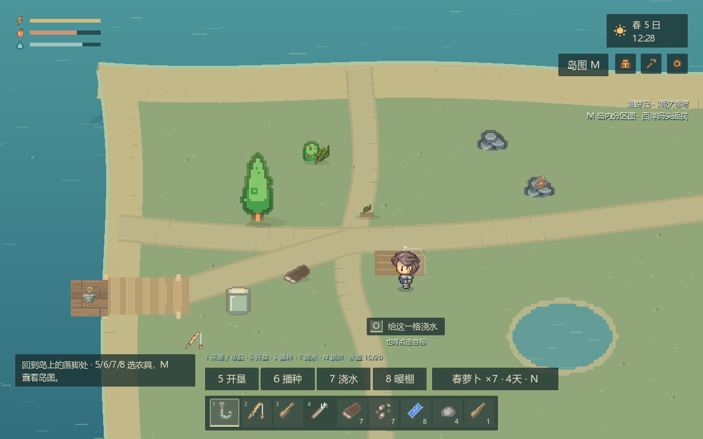
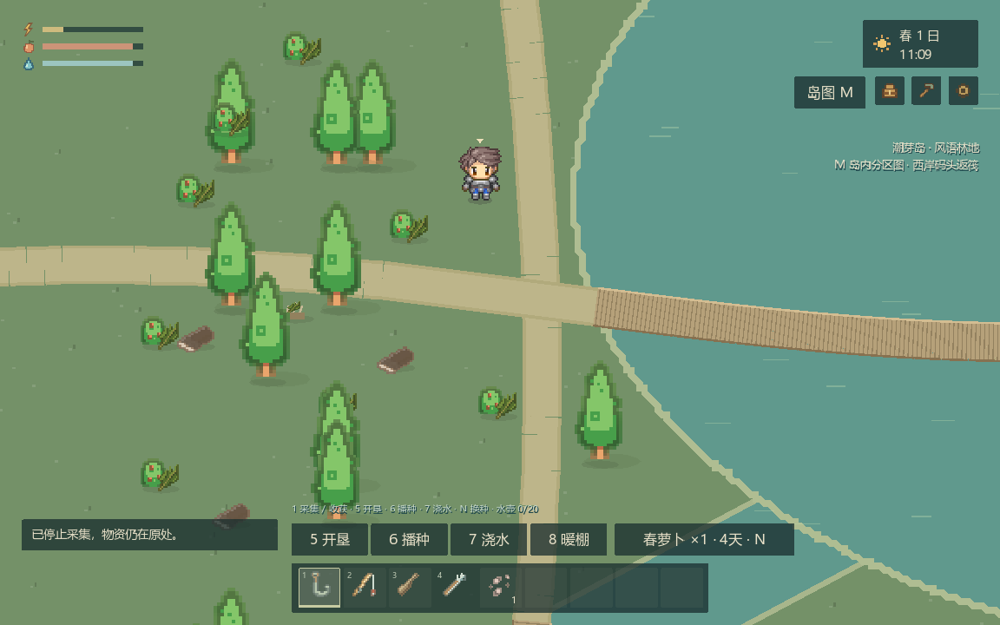
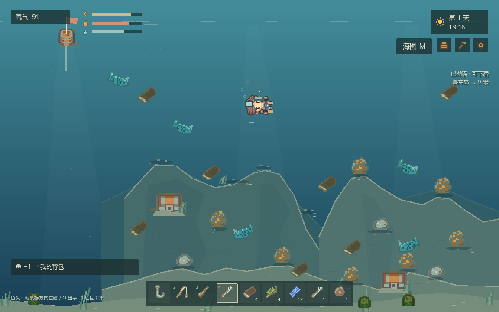

# 潮间小屋美术规范

更新：2026-10-05。适用基线：0.10。开发约束见 [AGENTS.md](../AGENTS.md)，排期唯一入口是 [TODO.md](TODO.md)，本文件维护视觉标准与素材验收清单。素材接入与风格统一尚未因本文建立而完成。

## 方向与参考画面

温暖、清楚、有生活细节的2D像素海岛世界。甲板和陆地为俯视角，水下为横版侧视角；用一致的人物身份、物件造型、材质、色彩和像素密度连接两种视角。固定镜头，保留克制的海浪/筏体动效，不用镜头摇晃制造动感。

用户喜欢星露谷的精致感，也已明确认可当前玩家人物。这是审美与角色保留依据，不代表星露谷素材可直接使用，也不代表现有环境、UI或水下已经获认可。以下保存项目自己的实际画面，未编辑原截图；没有把商业游戏截图或原素材当作可分发资产。

| 本轮保留的参考 | 采用/保留的部分 | 尚不能据此认定完成的部分 | 来源 |
|---|---|---|---|
| 陆地0.10 | 已获用户认可的玩家身份与头身比例，固定俯视视角，人物相对田格的可读大小 | 地形细节、建筑、植物和UI整体精度仍待调整 | artifacts/playthrough-20261005-122943-871/08-resumed-farm.png，正常流程 |
| 湖岸0.10 | 青绿水体、偏暖土地和材质色边缘可作为本轮色彩方向；湖岸/桥的空间关系可读 | 树形、重复纹理、桥与水岸衔接细节尚非最终品质 | artifacts/town-ui-3957151/lake-shore.png，位置夹具 |
| 水下0.8.1 | 同一玩家身份、工具/资源能辨认、横版视角 | 旋转站姿、鱼与矿物的比例/精度是待修正对照，不是认可的最终游泳方案 | artifacts/playthrough-20261005-103239-554/06-fish-spear.png，历史正常流程 |

这些图来自不同版本，只用于建立参考和识别缺口，不能证明同一版本陆地与水下已统一。后续P0-16必须补同版本实机对照；新参考需写明版本、来源、认可的具体方面和仍未认可的方面，保留旧记录。

## 像素、比例与视角

| 项目 | 接入标准 | 当前实现与差距 |
|---|---|---|
| 像素采样 | 使用最近邻采样；保持原图宽高比。记录原生像素尺寸及实际显示尺寸，不用模糊、任意拉伸掩盖风格冲突 | 项目已用最近邻。16px图标、原生32px人物、16px设计放大到32px的物品并存，仍需检查混用后的视觉像素密度 |
| 玩家与成人NPC | 以已认可的Pipoya玩家为锚点，保留其头身比、脸部细节和四向辨识；成人同场景采用相当显示比例。换装/潜水后仍能认出同一人 | 玩家每帧32×32，当前绘制外框48×48逻辑单位；岛上格子32×32，外框约1.5格，透明边不计人体。NPC目前40×40，差异列待调整，不能把缩小当职业差异 |
| 地格与建筑 | 岛格32逻辑单位、筏格64逻辑单位是玩法网格，不强制全部素材原图同尺寸。按玩家脚点核对门、床、树干、箱子、工具与碰撞范围；建筑可跨多格 | 玩家以脚点落地，树/建筑可以遮挡但不能藏住关键交互。新增建筑先做人物站门口及行走遮挡对照 |
| 陆地/甲板视角 | 俯视且能看到人物与物件的侧面厚度；同类资产俯视角度一致，底部接地，阴影方向一致 | 不混入等距建筑或纯侧视柜子。地面装饰与能采集/碰撞的对象要能区分 |
| 水下视角 | 横版侧视；需要真正侧向身体姿态和侧向工具动作，物体在水中应有合理朝向、尺度与浮沉关系 | 当前把站姿转90度再加面镜/气瓶，登记为占位；不能以此证明游泳视角和动作完整 |
| 道具与图标 | 同一种物品在海面、水下、场景、背包、配方和预览中保持身份与主色；世界尺寸服从实际用途，图标单独适配格子 | 继续复用ArtCatalog/PropArt出口；源图大小一致不代表显示比例一致。木桶/闭箱/开箱必须逐状态看 |

不规定全画面必须一律放大相同倍数：新素材先与实际玩家和邻近物件同屏比较；若非整数缩放导致像素宽窄跳动、边缘闪烁或混合精度明显，记为待调整并修改素材/显示方案。当前48/32的显示比例是已存在的事实，不作为未来所有素材都采用1.5倍缩放的许可。

## 色彩、边缘与动作

- 陆地偏暖木色、亚麻色与植被绿，海面和水下用青绿/蓝绿连接；水下可更冷、更暗，但人物、鱼叉、鱼、矿点与宝箱必须从背景中读出来。
- 材质色锚点沿用 [prop-palette.md](../assets/prop-palette.md)：木材`#987958`、亚麻`#9c9981`、金属`#81928b`、石料`#939489`、植被`#7f9461`、水`#709d9f`。这是适配起点，不是给所有原图套同一种灰色滤镜。
- 避免物资、设施和UI出现突兀的厚黑框；轮廓用较深材质色，内凹处可保留暗部。已认可人物走独立人物素材出口，不能为统一轮廓把人物细节全部抹掉。
- 同一素材必须检查闲置、操作中、完成、打开/关闭、空/满、种植各阶段等实际适用状态。不能只改木箱闭合图而漏掉开箱，也不能只改背包图而漏掉水下实体。
- 动作至少要表达准备、作用方向、命中/完成和恢复。没有完整帧组时允许保留明确占位继续开发，但素材条目仍为“需补画”；不能让动作与采集计时/命中判定脱节。完整行走/游泳工程仍由P2-01排期，当前P0-16必须先识别并验证视角与基本姿态，不能假报动作完成。
- 同一背景、视口和实际游戏速度下检查人物移动/转向、挥工具、抛收钩、游动/鱼叉和受影响物体；静态接触表不能证明动作连贯。UI须保留正常字号、物品格、提示和交互目标的清晰层级，不能靠隐藏UI完成好看的截图。

## 素材状态清单

状态含义：**已验证**仅限该行写明的范围及证据；**待调整**为已有素材但比例/风格/状态或验收仍有缺口；**需补画**为适配视角/动作/独特内容缺失，可以补画或找到授权合适的替代素材。后两类都不能记为完成。授权记录与视觉验收分开，许可齐全不等于美术通过。

下表登记日期均为2026-10-05；后续修改某行时更新该行日期和证据，不把整表批量改成已验证。

| ID / 类别 | 状态与验证范围 | 当前来源/证据 | 缺口与下一步 | 对应TODO |
|---|---|---|---|---|
| ART-01 玩家陆地形象 | 已验证：当前玩家形象获用户认可；四方向取帧/基础步态已有检查。2026-10-05 | CharacterArt；Pipoya两张32px角色表；用户“人物现在可以了”；本页陆地实机图 | 保留人物。仅这部分通过，不扩大为完整人物动作或水下通过 | P0-06a / P2-01 |
| ART-02 潜水人物/装备动作 | 需补画。2026-10-05 | world_view._draw_swimmer；本页水下现状图 | 侧视待机/游动/转向/鱼叉姿态；同一服装/脸部身份、装备遮挡与原比例。旋转站姿为占位 | P0-16 / P2-01 |
| ART-03 八位居民 | 待调整。2026-10-05 | 两张Pipoya表改服色/帽子；world_view._draw_town；0.10镇内画面 | 40px与48px玩家的同屏比例；职业轮廓/配饰差异；独立角色缺口要逐人登记，八身份不等于八套美术 | P0-16 / P0-15 |
| ART-04 物资、工具、库存/配方图标 | 待调整。2026-10-05 | Yapi、Kenney与项目像素网格；ArtCatalog/PropArt；assets/sources.md | 已有目录/边缘技术检查，不代表视觉已认可；同物跨地面/水下/UI比较精度、尺寸和颜色 | P0-16 / P0-06b |
| ART-05 木桶、木箱、睡袋及加工设施 | 待调整。2026-10-05 | Kenney与项目绘制；prop-palette.md状态清单 | 统一边缘已接入，仍需实际闲置/开闭/加工/完成/预览及水下箱体逐态视觉验收 | P0-16 / P0-06c |
| ART-06 陆地、森林、房屋、湖岸/桥 | 待调整。2026-10-05 | 现有树图与程序地貌/建筑；本页陆地/湖岸图 | 降低大色块和重复感，核对门/树/人物比例、岸桥衔接、遮挡与可行走边界；不可牺牲大量可开垦土地 | P0-16 / P0-13 / P0-15 |
| ART-07 耕地、各季作物/成熟状态、暖棚 | 待调整。2026-10-05 | 程序绘制，0.10四夜种植实机证据 | 逐种核对幼苗/成长/成熟/枯萎辨识和工具比例；四种作物不能只靠文字区分 | P0-16 / P0-12 |
| ART-08 水下鱼、礁石、海草、矿点与沉箱 | 待调整。2026-10-05 | 现有道具与程序环境；本页水下历史图 | 同版检查水下侧视体积、鱼与人物大小、背景层次及互动轮廓；水中活鱼与背包食材图按用途适配 | P0-16 / P0-02 |
| ART-09 HUD、菜单与提示 | 待调整。2026-10-05 | UIStyle；0.10.1移除农事标签排，使用现有图标显示12格背包；artifacts/held-item-ui-2104299/held-item-island.png | 已检查本轮实际物品栏和水量显示，不等于整体美术验收；继续对照陆地/水下留白、对比与遮挡 | P0-16 / P0-06 |
| ART-10 建筑室内、洞内与未制作角色动作 | 需补画。2026-10-05 | 当前无完整对应内容；封闭入口/门前服务不算其素材 | 玩法排到时列出实际场景、方向和状态需求，再补授权素材或绘制，不以地图标记占位关闭 | P1-06 / P1-02 / P1-03 / P2-01 |

## 接入与复核记录方式

1. 先列素材用途、目标视角、尺寸、动作/状态及玩法交互，逐项对照以上规范；采用真实候选素材放进实际场景，与已认可人物同屏，再决定接入。
2. 来源记录在 [assets/sources.md](../assets/sources.md)：作者、原始页面、取得版本/日期、许可证据及实际使用限制。沿用既有许可记录时核对对应文件；新增来源或用途变化时核实官方条款。许可未核实的候选不能作为已接入成品。项目原画/程序绘制同样说明来源方式，不冒充外包或手绘。
3. P0-16验证使用同一候选游戏版本、同等显示比例的陆地/甲板/水下截图与动作片段，包含玩家、鱼、木材/石矿、木桶/箱子、植被/环境及UI。检查正常窗口、另一种宽高比/全屏的缩放和真实操作；正常入口走完甲板→岛→水下→返航。存测试图时注明夹具；实机截图不自动代表真人审美通过。
4. 每条结论记录日期、版本、素材ID/文件、原图与显示尺寸、五项检查结果、实机证据路径、验证人（工具检查/开发者观察/用户确认分别写）、剩余缺口与下一步。技术检查、视觉观察和用户认可不能互相代替。
5. 新增/替换素材、发现缺口或收到用户反馈，在同一轮更新本表与TODO对应ID。缺项可新增ART编号，保留原条目与历史证据；不能为让全表好看而批量清空缺口。排期只在TODO维护，许可只在sources维护，本文件链接过去。

## 变更记录

- 2026-10-05（0.10.1）：按用户反馈移除农事操作标签，复用现有物品图标和UIStyle选中样式，岛上展示12格实际背包。更新ART-09证据及P0-17；未新增素材，P0-16风格统一仍待办。

- 2026-10-05：建立规范；保存三张既有实机参考，核对32px玩家原图、48px玩家显示、40pxNPC显示及旋转站姿水下实现。认可范围限定为现有玩家形象；陆地与水下统一列当前P0-16待办。未新增游戏素材，未替换现有渲染，未将占位标为完成。
